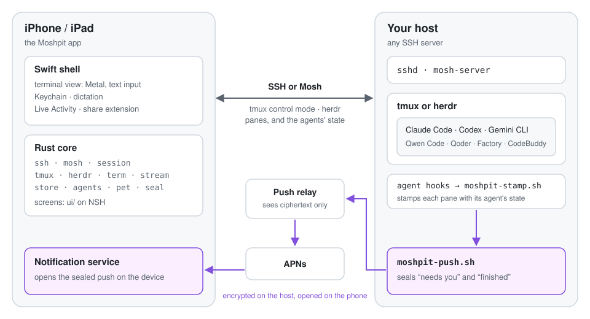

<!-- source: README.md 15a3988797c7d1c05e6d194c1a5cbbbe842130ca -->
<div align="center">


# Moshpit

### 编程智能体在你的机器上跑，你在手机上回它。

**Claude Code、Codex、Gemini 在服务器上接着干活；哪个需要你拍板，手机就知道。**<br>
iPhone 和 iPad 上的 SSH、Mosh、tmux、herdr 终端：每个提问都是一条端到端加密的推送，<br>
实时活动一直挂着谁在等你、谁在干活、各自多久了。

[](https://apps.apple.com/app/id6799896801)  [](LICENSE)

**[App Store](https://apps.apple.com/app/id6799896801)** &nbsp;·&nbsp; **[官网](https://moshpit.cluas.eu.org/zh)** &nbsp;·&nbsp; **[文档](https://moshpit.cluas.eu.org/zh/docs)** &nbsp;·&nbsp; **[Issues](https://github.com/Cluas/moshpit/issues)**

[English](README.md) · **简体中文** · [繁體中文](README.zh-Hant.md) · [日本語](README.ja.md) · [한국어](README.ko.md) · [Deutsch](README.de.md) · [Español](README.es.md) · [Français](README.fr.md) · [Português (Brasil)](README.pt-BR.md)

<br>

  

</div>

<br>

## 适合你吗？

如果你在一台 SSH 连得上的机器上（工作站、服务器、云主机）跑 Claude Code、Codex、Gemini CLI 这类编程智能体，多半还套着 tmux 或 herdr，又想离开电脑时也能在手机上回它，Moshpit 就是为你做的：

- **该你出场时会知道。** 智能体一提问，锁屏上就来一条推送，在你的主机上加密、到手机上才解开，点一下就落在提问的那个窗格里。
- **所有智能体一眼看全。** 首页先列出所有主机上「在等你」的，往下是谁在干活、干了多久，最后是谁闲着。
- **一个真正的终端。** Mosh 换网络也不断，tmux 的窗口和窗格原生显示、能直接管，有快捷键栏，能显示图片。

如果你的智能体不在你连得上的机器上跑，它就不适合你：Moshpit 是终端，不是跑智能体的地方，也不是托管智能体的聊天 App。它只有 iPhone 和 iPad 版；安卓版还在开发，没有发布。

## 快速上手

**1 · 安装。** 在 [App Store](https://apps.apple.com/app/id6799896801) 买断（一次性付费），或者[自己从源码构建](#从源码构建)。

**2 · 添加主机。** 填地址和用户名，登录方式选密码或 SSH 密钥：可以在手机上生成，也可以导入，或者直接粘贴 PEM。任何 SSH 服务器都能连。

**3 · 配置主机（可选）。** 「配置主机」会装上报告智能体状态的状态脚本，并把这台主机和手机配对，好收推送。改动主机上的任何东西之前都会先问你。Codex 还要在主机上多做一步：在 Codex 里运行 `/hooks`，信任 Moshpit 的那四条。

**4 · 装 Mosh、tmux 或 herdr（可选）。** Mosh 让会话在换网络时不断；tmux 和 herdr 让窗格原生显示。App 里每样都带安装指引。

## 支持的智能体

| 智能体 | 状态 | 在等你 | 已完成 |
| :-- | :-: | :-: | :-: |
| Claude Code | ✓ | ✓ | ✓ |
| Codex | ✓ | ✓ ¹ | ✓ |
| Gemini CLI | ✓ | ✓ ² | ✓ |
| Qwen Code | ✓ | ✓ | ✓ |
| Qoder | ✓ | ✓ | ✓ |
| Factory（`droid`） | ✓ | ✓ | ✓ |
| CodeBuddy | ✓ | ✓ | ✓ |

**状态**显示在首页、灵动岛和实时活动里；**在等你**和**已完成**是推送。¹ Codex 在要权限时提问。² Gemini CLI 只在工具要权限时提问。

「配置主机」只给它在主机上找到的智能体装状态脚本。在 tmux 上，首页的状态来自这些脚本；在 herdr 上，状态由 herdr 自己报告，什么都不用配。推送则不管智能体跑在哪儿都由状态脚本发出：tmux 里、herdr 里，还是普通的 shell 里。

「在等你」的推送会先等 30 秒：你在电脑前 30 秒内答了，手机就不会响。「已完成」的推送会带上这一轮跑了多久，主机上装了 `jq` 的话还会说它回答的是哪句提示词；跑满三分钟的会响铃，短的静悄悄地进列表。

## 怎么连在一起的

<picture>
  <source media="(prefers-color-scheme: dark)" srcset="docs/assets/architecture-dark.svg">
  
</picture>

App 通过 SSH 或 Mosh 连到你的主机，用控制模式驱动 tmux，用 herdr 自己的协议驱动 herdr，所以窗格是原生画出来的，每个智能体的状态也是作为数据传过来，而不是从输出里猜。主机上，每个智能体的状态脚本会调用一个小脚本：把智能体的状态标在窗格上；遇到「在等你」和「已完成」，再用「配置主机」时配对的密钥把推送加密。推送服务只负责把加密好的信封转给 APNs，只看得到密文；手机上的通知服务把它解开。推送协议从头到尾的细节见 [docs/PUSH.md](docs/PUSH.md)。

## 能做什么

### 首先是一个真正的终端

<p align="center">
 
</p>

| 功能 | 说明 |
| :-- | :-- |
| **SSH 和 Mosh** | Mosh 带预测回显。Wi-Fi 和 5G 来回切、手机息屏、酒店的烂网络，会话都不断；App 在后台待过一阵回来，连接还活着就直接接着用，不用重连 |
| **连不上会说为什么** | 端口拒绝了连接，主机名解析不出来（或者没给本地网络权限），对方没应答（看看 VPN），还是从这个网络根本没有到它的路由 |
| **tmux 控制模式** | 原生渲染，窗口和窗格能新建、改名、关闭。不是把一块桌面硬塞进手机屏 |
| **[herdr](https://github.com/herdrdev/herdr)** | 专门给编程智能体做的多路复用器，一次只画一个满宽窗格 |
| **窗格总览** | 一个会话的所有窗口和窗格一屏摆开，每个都是它屏幕的实时画面，tmux 和 herdr 都一样。左右滑就在窗格之间切换 |
| **tmux 没了的时候** | tmux 服务器被杀掉或崩了，首页不会再把它的会话和智能体当成还在跑，终端里直接给出「新建会话」 |
| **用 Metal 画** | 内核是我们改过的 wezterm 终端：能显示图片（kitty、iTerm2、sixel），能在历史里查找，选区带拖动手柄，翻历史时手指一甩还会顺着惯性滑一段 |
| **输入** | esc / ctrl / alt / 方向键的快捷键栏，输入法组合输入，链接点得开，自定义主题，七种终端字体 |
| **主机** | 每台主机有自己的头像：由主机密钥画出来，同一把密钥永远是同一张脸；也可以换成你挑的 emoji。换新 iPhone 从备份恢复以后，Moshpit 会列出哪些密码和密钥留在了旧手机上（钥匙串里的东西本来就不跟着备份走），你重新填一遍或重新导入就行；已经信任过的主机密钥照样算信任过 |

### 为智能体干活而做

<p align="center">

</p>

| 功能 | 说明 |
| :-- | :-- |
| **「在等你」排最前** | 首页最上面是所有主机上等你回话的智能体。往下是谁在干活、干了多久、谁闲着 |
| **推送直接上锁屏** | 端到端加密，App 没开也照样送到。点一下，就在提问的那个窗格里 |
| **实时活动** | 锁屏和灵动岛上一直挂着：谁在等你、谁在干活、各自多久了 |
| **新开一个 worktree** | 在手机上给智能体开一个新的 git worktree：选仓库、起分支名，顺手把第一句提示词也交给它 |
| **分享进窗格** | 从任何 App 分享一张图，直接进到智能体的窗格 |

### 智能体提到的文件

<p align="center">

</p>

点一下智能体输出里的路径，文件就在手机上打开：图片直接看，视频直接放，文本直接读。还能翻它所在的文件夹，顺手分享出去。

### 语音

听写在本机完成。**Qwen3-ASR**（0.6B，第一次用时下载一次）能把夹着英文术语的中文当一整句听，还会把窗格屏幕上的文件名、分支名和智能体名当作热词。也可以用 **Whisper** 和苹果自带的本机识别。录音不离开手机。

### iPad

<p align="center">

</p>

左边主机，右边终端。接外接键盘时 <kbd>⌘K</kbd> 显示全部窗格，<kbd>⌘1</kbd>–<kbd>⌘9</kbd> 切窗口，<kbd>⌘W</kbd> 回到首页。

### 伙伴和图标

<p align="center">

</p>

| 功能 | 说明 |
| :-- | :-- |
| **像素伙伴** | 在首页从蛋里孵出来，蹲在最需要你的那个智能体的卡片上，跟着它的状态变，灵动岛和实时活动里也有它。打开以后，每台主机的头像也变成一只像素小怪，长相同样由主机密钥决定 |
| **22 个桌面图标** | 都在设置里：默认是一颗像素蛋；六种伙伴各有一个从窗格后面探出头的图标，每种还有一个闪光版；另有 Classic 和其他八个。伙伴孵出来以后，首页会问你要不要换成它那一种 |

这里的截图都是 App Store 用的那一套，由 Screenshots 工作流生成，每次完整跑完就自动换上新的。其他语言和 iPad 的截图见[全部截图](https://blog.cluas.eu.org/moshpit/shots/#zh-Hans)。

## 光明正大

- 一次性买断。没有订阅，没有账号，没有功能分层。
- 不收集任何数据：没有统计，没有追踪。密钥留在 iOS 钥匙串里，流量只去你自己的服务器，外加一台只看得到密文的推送服务。
- Moshpit 不经你同意不往主机上装东西，不会背着你开会话；连接降级时会直说，而不是默默换一种方式连。

## 怎么搭起来的

Moshpit 大部分是 Rust 写的。核心在 `crates/` 里：SSH（`ssh`，基于 russh）、Mosh 的协议（`mosh`）、负责拨号、重连和回来接着用的会话层（`session`）、tmux 控制模式（`tmux`）和 herdr（`herdr`）、终端模拟器（`term`，底下是 `vendor/wezterm` 里我们改过的 wezterm）、App 要存的东西（`store`）、智能体的状态机（`agents`）、像素伙伴（`pet`），以及主机配置和推送配对（`hostcare`、`install`、`seal`）。界面也是 Rust 写的，用的是 [NSH](https://nsh.dev)，放在 `ui/`，界面背后的模型在 `crates/app`。

iOS 上只有薄薄一层 Swift，通过一个静态库（`crates/ffi`）把这些接进来：App 本身的外壳、终端视图的 Metal 绘制和文字输入、钥匙串、听写（Qwen3-ASR 跑在 sherpa-onnx 的 onnxruntime 上，Whisper 用 WhisperKit，再加上苹果自带的识别），以及 iOS 只让自己人做的那几样：实时活动和小组件、在本机解开推送的通知服务（它通过 `crates/seal-ffi` 调用 `seal`）、分享扩展。安卓版和 iOS 共用同一套核心和界面（`crates/android`、`android/`），还在开发中，没有发布。

<details>
<summary><b>仓库结构</b></summary>

<br>

| 路径 | 放的是什么 |
| :-- | :-- |
| `crates/` | Rust 核心，一件事一个 crate：`ssh`、`mosh`、`session`、`tmux`、`herdr`、`term`、`stream`（窗格的字节在核心和终端视图之间的通道）、`store`、`agents`、`pet`（像素伙伴）、`seal`（推送的信封格式）、`seal-ffi`（通知服务用它解开推送）、`hostcare`、`install`、`app`（各个界面的模型）、`runtime`、`copy`（中文文案守的规矩）、`ffi`（iOS 链接的静态库）、`android`（安卓版的 Rust 那一半） |
| `ui/` | 用 Rust 和 NSH 写的界面，iOS 和安卓共用 |
| `vendor/wezterm/` | 我们改过的 wezterm 终端模拟器，接在 `crates/term` 后面；改了什么见 [docs/WEZTERM-PATCHES.md](docs/WEZTERM-PATCHES.md) |
| `Moshpit/` | iOS 这一层：App 外壳、每个界面在 Swift 这边的部分、终端视图的 Metal 绘制和文字输入、钥匙串、听写（Qwen3-ASR、Whisper、苹果自带的识别） |
| `Extensions/` | 三个 App 扩展：`MoshpitIsland/`（实时活动和锁屏小组件，Vibe Island）、`MoshpitPush/`（在本机解开推送的通知服务）、`MoshpitShare/`（把图片交给智能体的窗格） |
| `Packages/MoshpitKit/` | App 和三个扩展都链接的本地 Swift 包：日志、实时活动的数据、加密推送的信封格式和配对存储 |
| `android/` | 安卓 App（Gradle），开发中 |
| `Tests/` | `MoshpitTests/` 单元测试，`MoshpitUITests/` UI 测试 |
| `push-relay/` | 你的主机和 APNs 之间那台不存状态的 Go 推送服务，部署清单在 `deploy/` |
| `docs/` | [ARCHITECTURE.md](docs/ARCHITECTURE.md)、[PUSH.md](docs/PUSH.md)（推送协议从头到尾）、[WEZTERM-PATCHES.md](docs/WEZTERM-PATCHES.md)、`nsh/`（Rust 核心和 NSH 界面的设计笔记）、其他设计笔记 |
| `scripts/` | `rust/` iOS 静态库的构建和 Swift 绑定，`host/` 装到你开发机上的脚本，`gen/` 生成器，`verify/` 端到端检查，`spikes/` 试验，`wezterm/` 从上游导入 wezterm，`release/` 打包工具 |

</details>

App 默认走维护者自己架的推送服务；它能看到什么、看不到什么，以及怎么自己架一台，见 [docs/PUSH.md](docs/PUSH.md)。

## 从源码构建

需要装有 Xcode 27 的 macOS（App 面向 iOS 18）、[XcodeGen](https://github.com/yonaskolb/XcodeGen)（`brew install xcodegen`），以及用 [rustup](https://rustup.rs) 装的 Rust。仓库在 `rust-toolchain.toml` 里钉死了工具链版本，rustup 第一次用到时会自己装上。

```sh
git clone https://github.com/Cluas/moshpit.git
cd moshpit
xcodegen generate        # project.yml 是唯一的来源，.xcodeproj 由它生成
open Moshpit.xcodeproj
```

选 **Moshpit** scheme 和一台模拟器，按 ⌘R。App target 里的「Build Rust」阶段会跑 `scripts/rust/build-ios.sh`，把 `crates/ffi` 编成给模拟器或真机用的 `libmoshpit_ffi.a`，第一次会顺手装上需要的 Rust target（`aarch64-apple-ios-sim`、`aarch64-apple-ios`）。Debug 用 cargo 的 `app-test` 配置，Release 用 `app`。第一次构建要把整套 Rust 编一遍，得等一会儿，之后就是增量的。Swift 包也在第一次构建时自动拉取。

真机构建要在 `Signing.xcconfig` 里填你的 Team ID，文件里的注释和 [docs/install-free-account.md](docs/install-free-account.md) 一步步讲了怎么填，免费 Apple ID 也行。

### 测试

Rust 这边，和 CI 跑的一样：

```sh
cargo test --workspace --locked
cargo clippy --workspace --all-targets --locked -- -D warnings
cargo test -p moshpit-term        # 只测一个 crate
```

iOS App，和 CI 在 Xcode 27 镜像上跑的一样：

```sh
scripts/rust/test-build-ios.sh    # 不编译，只查 Rust 阶段用的配置和链接
xcodebuild test -project Moshpit.xcodeproj -scheme Moshpit \
  -destination 'platform=iOS Simulator,name=iPhone 18 Pro' CODE_SIGNING_ALLOWED=NO
```

有几组测试在没签名的构建里会跳过（它们要用 App Group 容器），有几组只在 iPad 模拟器上跑（外接键盘的快捷键），还有一些 UI 流程在按现在的界面重写之前也先跳过；日志里会写明是哪些。

安卓版用 `android/ci.sh` 构建和测试，装好 JDK 17 就行，SDK、NDK、Gradle 这些它会自己去拿。

## 参与

先读 [CONTRIBUTING.md](CONTRIBUTING.md)，里面有工作流程和代码风格；报告敏感问题前请先看 [SECURITY.md](SECURITY.md)。所有人都遵守[行为准则](CODE_OF_CONDUCT.md)。

Moshpit 在 [LINUX DO](https://linux.do) 上分享过。有问题、有想法，在那边说和在 issue 里说都一样欢迎。

## 许可

Moshpit 是自由软件，以 [GNU 通用公共许可证 v3.0](LICENSE)（GPL-3.0-only）发布。你可以按这份许可的条款构建、修改和再分发它。App Store 上的版本由持有版权的维护者发布。第三方组件保留各自的许可，列在 [NOTICES.md](NOTICES.md) 里。
