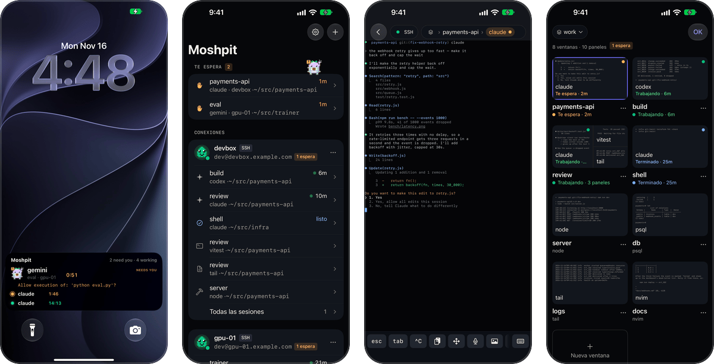
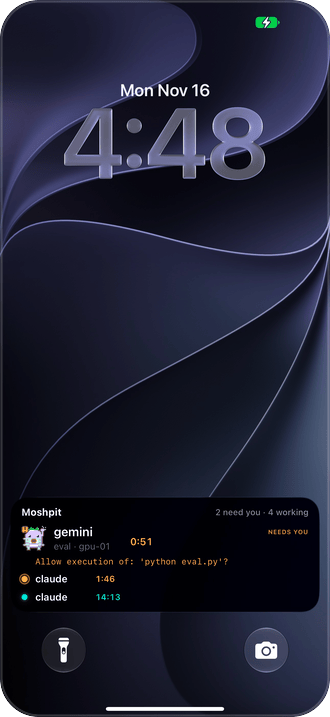
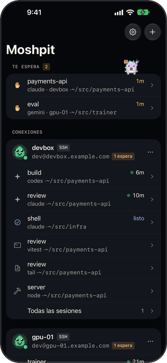
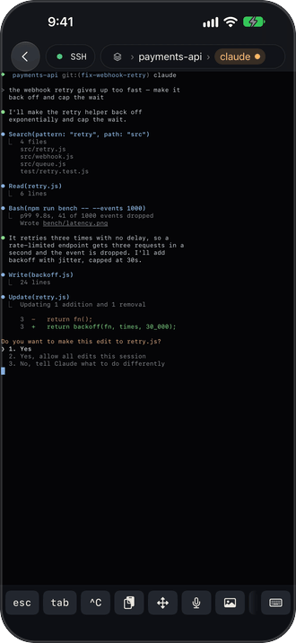
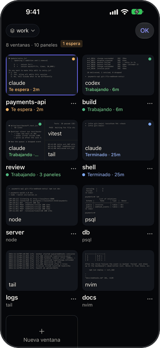
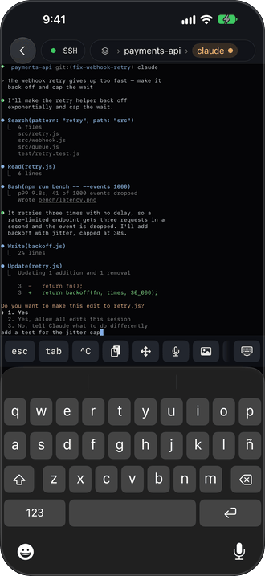
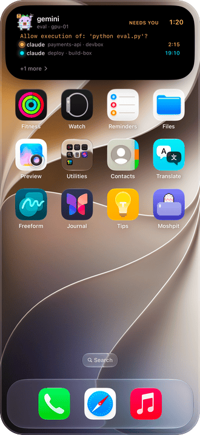
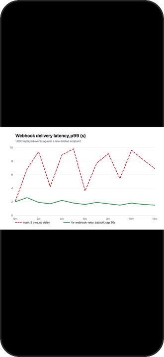
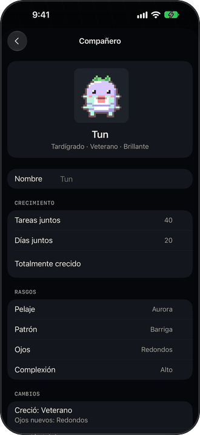

<!-- source: README.md 15a3988797c7d1c05e6d194c1a5cbbbe842130ca -->
<div align="center">


# Moshpit

### El terminal para agentes de programación en tus propias máquinas.

**Claude Code, Codex y Gemini siguen trabajando en el servidor. Cuando uno te necesita, tu teléfono se entera.**<br>
SSH, Mosh, tmux y herdr en iPhone y iPad, con una notificación push cifrada por cada pregunta<br>
y una Actividad en Vivo que muestra quién te espera, quién trabaja y desde hace cuánto.

[](https://apps.apple.com/app/id6799896801)  [](LICENSE)

**[App Store](https://apps.apple.com/app/id6799896801)** &nbsp;·&nbsp; **[Sitio web (en inglés)](https://moshpit.cluas.eu.org)** &nbsp;·&nbsp; **[Documentación (en inglés)](https://moshpit.cluas.eu.org/docs)** &nbsp;·&nbsp; **[Issues](https://github.com/Cluas/moshpit/issues)**

[English](README.md) · [简体中文](README-zh.md) · [繁體中文](README.zh-Hant.md) · [日本語](README.ja.md) · [한국어](README.ko.md) · [Deutsch](README.de.md) · **Español** · [Français](README.fr.md) · [Português (Brasil)](README.pt-BR.md)

<br>

<a href="#gallery"></a>

</div>

<br>

## ¿Moshpit es para ti?

Sí, si usas Claude Code, Codex, Gemini CLI u otro agente de programación en una máquina a la que llegas por SSH (una estación de trabajo, un servidor, una máquina en la nube), muchas veces dentro de tmux o herdr, y quieres contestar desde el teléfono al agente que te pregunta en lugar de volver a sentarte frente al equipo:

- **Te enteras cuando te necesitan.** La pregunta llega a la pantalla bloqueada como notificación push, cifrada en tu host y descifrada en el teléfono, y con un toque estás en el panel que preguntó.
- **Todos los agentes de un vistazo.** Inicio muestra primero quién te espera en todos tus hosts, después quién está trabajando y desde hace cuánto, y al final quién está inactivo.
- **Un terminal de verdad.** Mosh, que aguanta los cambios de red; ventanas y paneles de tmux gestionados de forma nativa; una barra de atajos; imágenes en línea.

No, si tus agentes no se ejecutan en una máquina a la que puedas llegar: Moshpit es un terminal, no un sitio donde ejecutar un agente ni una app de chat para un agente alojado como servicio. Solo existe para iPhone y iPad; la app de Android está en desarrollo y aún no se ha publicado.

## Primeros pasos

**1 · Instala** Moshpit desde el [App Store](https://apps.apple.com/app/id6799896801) (pago único) o [compílalo tú mismo](#compilar-desde-el-código-fuente).

**2 · Añade un host.** Indica una dirección y un usuario, e inicia sesión con una contraseña o una clave SSH: puedes generar una clave en el teléfono, importar una clave o pegar un PEM. Sirve cualquier servidor SSH.

**3 · Configura el host (opcional).** *Configurar un host* instala los hooks que informan del estado de cada agente y empareja el host para las notificaciones push. Antes de cambiar nada en el host, te pregunta. Codex necesita un paso más en el host: ejecuta `/hooks` en Codex y confía en las cuatro entradas de Moshpit.

**4 · Añade Mosh, tmux o herdr (opcional).** Mosh mantiene la sesión aunque cambie la red; tmux y herdr te dan sus paneles de forma nativa. La app incluye una guía de instalación para cada uno.

## Agentes compatibles

| Agente | Estado | Te espera | Terminado |
| :-- | :-: | :-: | :-: |
| Claude Code | ✓ | ✓ | ✓ |
| Codex | ✓ | ✓ ¹ | ✓ |
| Gemini CLI | ✓ | ✓ ² | ✓ |
| Qwen Code | ✓ | ✓ | ✓ |
| Qoder | ✓ | ✓ | ✓ |
| Factory (`droid`) | ✓ | ✓ | ✓ |
| CodeBuddy | ✓ | ✓ | ✓ |

El **estado** aparece en Inicio, en la Dynamic Island y en la Actividad en Vivo; **Te espera** y **Terminado** son notificaciones push. ¹ Codex avisa con sus solicitudes de permiso. ² Gemini CLI solo avisa cuando una herramienta necesita permiso.

*Configurar un host* instala los hooks de los agentes que encuentra en el host. Con tmux, el estado que ves en Inicio sale de esos hooks; con herdr lo informa el propio herdr, sin configurar nada. Las notificaciones salen de los hooks esté donde esté el agente: en tmux, en herdr o en una shell normal.

La notificación «Te espera» aguarda 30 segundos antes de salir, así que una pregunta que respondes desde tu equipo nunca llega al teléfono. La de «Terminado» dice cuánto duró el turno y, si el host tiene `jq`, el prompt al que respondió; un turno de tres minutos o más suena, uno más corto llega en silencio.

## Cómo encaja todo

<picture>
  <source media="(prefers-color-scheme: dark)" srcset="docs/assets/architecture-dark.svg">
  
</picture>

La app llega a tu host por SSH o Mosh y maneja tmux con su modo de control y herdr con su propio protocolo, así que los paneles se dibujan de forma nativa y el estado de cada agente llega como datos, en lugar de deducirse de lo que imprime. En el host, los hooks de cada agente llaman a un pequeño script que marca el panel con el estado del agente y, para «Te espera» y «Terminado», cifra una notificación con la clave emparejada en *Configurar un host*. El servidor relay reenvía ese sobre cifrado a APNs y solo ve texto cifrado; el servicio de notificaciones del teléfono lo abre. [docs/PUSH.md](docs/PUSH.md) describe el protocolo de principio a fin.

## Qué hace

### Ante todo, un terminal

| Función | Qué significa |
| :-- | :-- |
| **SSH y Mosh** | Mosh con su eco predictivo. Las sesiones aguantan el paso de Wi-Fi a 5G y viceversa, el reposo del teléfono y las malas redes de hotel, y una conexión que siguió viva mientras la app estaba en segundo plano se retoma sin reconectar |
| **Te dice por qué no conecta** | El puerto rechazó la conexión, el nombre no se resolvió (o el permiso de Red local está desactivado), el host no respondió (revisa tu VPN) o no hay ruta hasta él desde esta red |
| **Modo de control de tmux** | Renderizado nativo, con ventanas y paneles que puedes crear, renombrar y matar. Nada de un escritorio falso en miniatura metido a presión en el teléfono |
| **[herdr](https://github.com/herdrdev/herdr)** | El multiplexor hecho para agentes de programación, con un solo panel a todo el ancho cada vez |
| **Vista de todos los paneles** | Todas las ventanas y paneles de la sesión a la vez, cada uno con una imagen en vivo de su pantalla, tanto en tmux como en herdr. Desliza hacia los lados para pasar de un panel a otro |
| **Cuando tmux desaparece** | Si el servidor de tmux muere o se cae, Inicio deja de mostrar sus sesiones y agentes como activos, y el terminal te ofrece «Nueva sesión» |
| **Dibujado con Metal** | Sobre un fork del núcleo de terminal de wezterm: imágenes en línea (kitty, iTerm2, sixel), buscar en el historial, selección con tiradores y un desplazamiento por el historial que conserva la inercia |
| **Escritura** | Barra de atajos con esc / ctrl / alt / flechas, composición con el método de entrada, enlaces que se abren con un toque, temas personalizados y siete tipos de letra para el terminal |
| **Hosts** | Cada host lleva una cara dibujada a partir de su clave del host (la misma clave, siempre la misma cara) o el emoji que elijas. En un iPhone nuevo restaurado desde una copia de seguridad, Moshpit te enumera las contraseñas y claves que se quedaron en el anterior (lo que guarda el llavero nunca viaja) para que vuelvas a escribirlas o importarlas, y las claves de host en las que ya confiabas siguen siendo de confianza |

### Pensado para trabajar con agentes

| Función | Qué significa |
| :-- | :-- |
| **Primero, «Te espera»** | Inicio muestra arriba todos los agentes que te esperan, en todos tus hosts. Debajo, quién está trabajando, desde hace cuánto y quién está inactivo |
| **Notificaciones en la pantalla bloqueada** | Cifradas de extremo a extremo y entregadas aunque la app esté cerrada. Tocas una y estás en el panel que preguntó |
| **Actividad en Vivo** | En la pantalla bloqueada y en la Dynamic Island: quién te espera, quién trabaja y desde hace cuánto |
| **Un worktree nuevo** | Arranca un agente en un git worktree nuevo desde el teléfono: elige un repositorio, ponle nombre a una rama y, si quieres, pásale el primer prompt |
| **Compartir en un panel** | Comparte una imagen desde cualquier app directamente en el panel de un agente |

### Archivos que menciona un agente

Toca una ruta en la salida de un agente y el archivo se abre en el teléfono: una imagen se previsualiza, un vídeo se reproduce y el texto se lee como texto. Desde ahí puedes recorrer su carpeta y compartir el archivo.

### Voz

El dictado se hace en el dispositivo. **Qwen3-ASR** (0.6B, se descarga una sola vez) entiende como una sola frase el chino hablado con términos en inglés, y toma como palabras prioritarias los nombres de archivo, la rama y el agente que aparecen en la pantalla del panel. También están **Whisper** y los motores de Apple que funcionan en el dispositivo. El audio nunca sale del teléfono.

### iPad

Los hosts a la izquierda y el terminal a la derecha. Con un teclado físico, <kbd>⌘K</kbd> muestra todos los paneles, <kbd>⌘1</kbd>–<kbd>⌘9</kbd> eligen una ventana y <kbd>⌘W</kbd> vuelve a Inicio.

### El compañero y los iconos

| Función | Qué significa |
| :-- | :-- |
| **Un compañero de píxeles** | Eclosiona de un huevo en Inicio, se posa en la tarjeta del agente que más te necesita, adopta su estado y te hace compañía en la Dynamic Island y en la Actividad en Vivo. Con él activado, la cara de cada host se convierte en una criatura de píxeles, dibujada a partir de la misma clave |
| **Veintidós iconos** | Todos en Ajustes: un huevo de píxeles por defecto, el compañero asomando por encima de un panel para cada una de sus seis especies (cada una con su versión brillante), Classic y ocho más. Cuando tu compañero eclosiona, Inicio te pregunta si quieres cambiar al icono de su especie |

<a id="gallery"></a>

## Capturas

<table>
<tr>
<td align="center" valign="top"><a href="#gallery"></a><br>Quién te necesita y para qué, en la pantalla bloqueada.</td>
<td align="center" valign="top"><a href="#gallery"></a><br>Quién trabaja y quién te espera, de un vistazo.</td>
<td align="center" valign="top"><a href="#gallery"></a><br>Toca y llegas al panel que preguntó.</td>
<td align="center" valign="top"><a href="#gallery"></a><br>Todos los paneles de tmux y herdr en una pantalla.</td>
</tr>
<tr>
<td align="center" valign="top"><a href="#gallery"></a><br>Un teclado hecho para la terminal.</td>
<td align="center" valign="top"><a href="#gallery"></a><br>El progreso, en la Dynamic Island.</td>
<td align="center" valign="top"><a href="#gallery"></a><br>Abre el archivo que tu agente acaba de tocar.</td>
<td align="center" valign="top"><a href="#gallery"></a><br>Incuba un compañero pixelado para esperar juntos.</td>
</tr>
</table>

Capturas de la app tal cual, generadas por el workflow Screenshots y renovadas tras cada ejecución completa. Todos los idiomas y el iPad: [todas las capturas](https://blog.cluas.eu.org/moshpit/shots/#es-ES).

## Sin letra pequeña

- Pago único. Sin suscripción, sin cuentas, sin niveles de funciones.
- No se recopila nada: ni analíticas ni rastreo. Las claves se quedan en el llavero de iOS y el tráfico solo va a tus propios servidores, además de a un servidor relay de notificaciones que solo ve texto cifrado.
- Moshpit nunca instala nada en tu host sin preguntarte, nunca crea sesiones a tus espaldas y, cuando la conexión se degrada, te lo dice en lugar de cambiar de transporte en silencio.

## Cómo está hecho

Casi todo Moshpit está escrito en Rust. El núcleo vive en `crates/`: el transporte SSH (`ssh`, sobre russh), el protocolo de Mosh (`mosh`), la capa de sesión que conecta, reconecta y reanuda (`session`), el modo de control de tmux (`tmux`) y herdr (`herdr`), el emulador de terminal (`term`, nuestro fork de wezterm en `vendor/wezterm`), lo que guarda la app (`store`), la máquina de estados de los agentes (`agents`), el compañero (`pet`), y la configuración del host y el emparejamiento de notificaciones (`hostcare`, `install`, `seal`). Las pantallas también están escritas en Rust, con [NSH](https://nsh.dev), en `ui/`, y sus modelos en `crates/app`.

En iOS, una capa fina de Swift lo aloja todo a través de una única biblioteca estática (`crates/ffi`): el armazón de la app, el dibujado con Metal y la entrada de texto de la vista del terminal, el llavero, el dictado (Qwen3-ASR sobre el onnxruntime de sherpa-onnx, Whisper sobre WhisperKit y los motores de voz de Apple) y las partes que iOS se reserva para sí (la Actividad en Vivo y los widgets, el servicio de notificaciones que abre las notificaciones a través de `crates/seal-ffi` y la extensión para compartir). Una app de Android comparte el mismo núcleo y las mismas pantallas (`crates/android`, `android/`); está en desarrollo y aún no se ha publicado.

<details>
<summary><b>Estructura del repositorio</b></summary>

<br>

| Ruta | Qué contiene |
| :-- | :-- |
| `crates/` | El núcleo en Rust, un crate por responsabilidad: `ssh`, `mosh`, `session`, `tmux`, `herdr`, `term`, `stream` (los bytes de un panel entre el núcleo y la vista del terminal), `store`, `agents`, `pet` (el compañero), `seal` (el sobre de las notificaciones), `seal-ffi` (la única llamada del servicio de notificaciones a `seal`), `hostcare`, `install`, `app` (los modelos de las pantallas), `runtime`, `copy` (las reglas que cumple el texto en chino), `ffi` (la biblioteca estática que enlaza iOS) y `android` (la mitad en Rust de la app de Android) |
| `ui/` | Las pantallas, escritas en Rust con NSH y compartidas por iOS y Android |
| `vendor/wezterm/` | Nuestro fork del emulador de terminal de wezterm, detrás de `crates/term`; [docs/WEZTERM-PATCHES.md](docs/WEZTERM-PATCHES.md) enumera lo que cambia |
| `Moshpit/` | La parte de iOS: el armazón de la app, el lado Swift de cada pantalla, el dibujado con Metal y la entrada de texto de la vista del terminal, el llavero y el dictado (Qwen3-ASR, Whisper, los motores de Apple) |
| `Extensions/` | Las tres extensiones de la app: `MoshpitIsland/` (Actividad en Vivo y widget de la pantalla bloqueada, Vibe Island), `MoshpitPush/` (el servicio de notificaciones que descifra las notificaciones en el dispositivo), `MoshpitShare/` (pasa una imagen al panel de un agente) |
| `Packages/MoshpitKit/` | Paquete Swift local que enlazan la app y las tres extensiones: registro, los datos de la Actividad en Vivo, el sobre de las notificaciones cifradas y el almacén de emparejamientos |
| `android/` | La app de Android (Gradle), en desarrollo |
| `Tests/` | `MoshpitTests/`, pruebas unitarias; `MoshpitUITests/`, pruebas de interfaz |
| `push-relay/` | El servidor relay en Go, sin estado, que hay entre tu host y APNs, con su manifiesto de despliegue en `deploy/` |
| `docs/` | [ARCHITECTURE.md](docs/ARCHITECTURE.md), [PUSH.md](docs/PUSH.md) (el protocolo de notificaciones de principio a fin), [WEZTERM-PATCHES.md](docs/WEZTERM-PATCHES.md), `nsh/` (notas de diseño sobre el núcleo en Rust y las pantallas en NSH) y otras notas de diseño |
| `scripts/` | `rust/`: la compilación de la biblioteca de iOS y sus bindings de Swift; `host/`: los scripts de shell que se instalan en tu host de desarrollo; `gen/`: generadores; `verify/`: comprobaciones de extremo a extremo; `spikes/`: experimentos; `wezterm/`: las importaciones del fork desde upstream; `release/`: herramientas para archivar |

</details>

Por defecto, la app usa el servidor relay del mantenedor; [docs/PUSH.md](docs/PUSH.md) explica qué puede ver y qué no, y cómo montar el tuyo.

## Compilar desde el código fuente

Necesitas macOS con Xcode 27 (la app funciona desde iOS 18), [XcodeGen](https://github.com/yonaskolb/XcodeGen) con `brew install xcodegen`, y Rust instalado con [rustup](https://rustup.rs). El repositorio fija su toolchain en `rust-toolchain.toml`, así que rustup instala la correcta la primera vez que la usas.

```sh
git clone https://github.com/Cluas/moshpit.git
cd moshpit
xcodegen generate        # project.yml es la fuente de verdad; el .xcodeproj se genera a partir de él
open Moshpit.xcodeproj
```

Elige el scheme **Moshpit** y un simulador, y pulsa ⌘R. La fase «Build Rust» del target de la app ejecuta `scripts/rust/build-ios.sh`, que compila `crates/ffi` en `libmoshpit_ffi.a` para el simulador o el dispositivo y, la primera vez, añade el target de Rust que hace falta (`aarch64-apple-ios-sim`, `aarch64-apple-ios`). Las compilaciones Debug usan el perfil de cargo `app-test`, y las Release, `app`. La primera compilación construye todo el grafo de Rust y tarda un rato; las siguientes son incrementales. Los paquetes de Swift también se resuelven en la primera compilación.

Para compilar en un dispositivo necesitas tu Team ID en `Signing.xcconfig`; el comentario de ese archivo y [docs/install-free-account.md](docs/install-free-account.md) explican cómo, incluido el camino con un Apple ID gratuito.

### Pruebas

La parte de Rust, tal como la ejecuta la CI:

```sh
cargo test --workspace --locked
cargo clippy --workspace --all-targets --locked -- -D warnings
cargo test -p moshpit-term        # un solo crate
```

La app de iOS, tal como la ejecuta la CI en la imagen de Xcode 27:

```sh
scripts/rust/test-build-ios.sh    # comprueba los perfiles y el enlazado de la fase de Rust, sin compilar
xcodebuild test -project Moshpit.xcodeproj -scheme Moshpit \
  -destination 'platform=iOS Simulator,name=iPhone 18 Pro' CODE_SIGNING_ALLOWED=NO
```

Algunas suites se omiten en una compilación sin firmar (necesitan el contenedor del App Group) o fuera del simulador de iPad (atajos del teclado físico), y algunos flujos de interfaz se omiten hasta que se vuelvan a escribir para las pantallas actuales; el registro indica cuáles.

La app de Android se compila y se prueba con `android/ci.sh`, que descarga lo que necesita (las partes del SDK, el NDK, Gradle); basta con tener un JDK 17.

## Contribuir

Lee [CONTRIBUTING.md](CONTRIBUTING.md) para conocer el flujo de trabajo y el estilo de la casa, y [SECURITY.md](SECURITY.md) antes de reportar algo delicado. Aquí todo el mundo sigue el [Código de conducta](CODE_OF_CONDUCT.md).

Moshpit se comparte en [LINUX DO](https://linux.do), una comunidad de desarrolladores en chino. Las preguntas y las ideas son tan bienvenidas allí como en las issues del repositorio.

## Licencia

Moshpit es software libre, publicado bajo la [Licencia Pública General de GNU v3.0](LICENSE) (GPL-3.0-only). Puedes compilarlo, modificarlo y redistribuirlo según los términos de esa licencia. La versión del App Store la publica el mantenedor, que es el titular de los derechos de autor. Los componentes de terceros conservan sus propias licencias, que se enumeran en [NOTICES.md](NOTICES.md).
