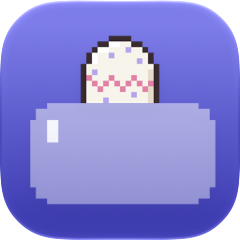

<!-- source: README.md 2d4fb4a3e4f6551abe6e997954516d14aadde7dd -->
<div align="center">



# Moshpit

### Le terminal de vos agents de codage, sur vos propres machines.

**Claude Code, Codex et Gemini continuent de travailler sur le serveur. Dès que l’un d’eux a besoin de vous, votre téléphone vous prévient.**<br>
SSH, Mosh, tmux et herdr sur iPhone et iPad, avec une notification push chiffrée pour chaque question<br>
et une Activité en direct qui affiche qui attend, qui travaille, et depuis combien de temps.

[](https://apps.apple.com/app/id6799896801)  [](LICENSE)

**[App Store](https://apps.apple.com/app/id6799896801)** &nbsp;·&nbsp; **[Site web (en anglais)](https://moshpit.cluas.eu.org)** &nbsp;·&nbsp; **[Documentation (en anglais)](https://moshpit.cluas.eu.org/docs)** &nbsp;·&nbsp; **[Issues](https://github.com/Cluas/moshpit/issues)**

[English](README.md) · [简体中文](README-zh.md) · [繁體中文](README.zh-Hant.md) · [日本語](README.ja.md) · [한국어](README.ko.md) · [Deutsch](README.de.md) · [Español](README.es.md) · **Français** · [Português (Brasil)](README.pt-BR.md)

<br>

  

</div>

<br>

## Moshpit est-il fait pour vous ?

Oui, si vous faites tourner Claude Code, Codex, Gemini CLI ou un autre agent de codage sur une machine que vous joignez en SSH (un poste de travail, un serveur, une machine dans le cloud), souvent dans tmux ou herdr, et que vous voulez répondre depuis votre téléphone à celui qui vous sollicite plutôt que de retourner devant votre ordinateur :

- **Savoir quand on a besoin de vous.** Une question arrive sur l’écran verrouillé sous forme de notification push, chiffrée sur votre hôte et déchiffrée sur le téléphone ; il suffit de la toucher pour arriver dans le panneau qui l’a posée.
- **Voir tous vos agents d’un coup.** L’accueil liste d’abord ceux qui vous attendent, sur tous vos hôtes, puis ceux qui travaillent et depuis combien de temps, puis ceux qui sont inactifs.
- **Un vrai terminal.** Mosh qui tient bon quand le réseau change, des fenêtres et des panneaux tmux gérés en natif, une barre de raccourcis, des images affichées dans le terminal.

Non, si vos agents ne tournent pas sur une machine que vous pouvez joindre : Moshpit est un terminal, pas un endroit où faire tourner un agent, ni une app de chat pour un agent hébergé. Il n’existe que sur iPhone et iPad ; l’app Android est en développement et n’est pas publiée.

## Démarrage rapide

**1 · Installez** Moshpit depuis l’[App Store](https://apps.apple.com/app/id6799896801) (achat unique), ou [compilez-le vous-même](#compiler-depuis-les-sources).

**2 · Ajoutez un hôte.** Indiquez une adresse et un utilisateur, puis connectez-vous avec un mot de passe ou une clé SSH : générez une clé sur le téléphone, importez-en une ou collez un PEM. N’importe quel serveur SSH fait l’affaire.

**3 · Configurez l’hôte (facultatif).** *Configurer un hôte* installe les hooks qui signalent l’état de chaque agent et jumelle l’hôte pour les notifications push. Rien n’est modifié sur l’hôte sans votre accord. Codex demande une étape de plus sur l’hôte : lancez `/hooks` dans Codex et approuvez les quatre entrées de Moshpit.

**4 · Ajoutez Mosh, tmux ou herdr (facultatif).** Mosh maintient la session quand le réseau change ; tmux et herdr vous donnent leurs panneaux en natif. L’app fournit un guide d’installation pour chacun.

## Agents pris en charge

| Agent | État | Vous attend | Terminé |
| :-- | :-: | :-: | :-: |
| Claude Code | ✓ | ✓ | ✓ |
| Codex | ✓ | ✓ ¹ | ✓ |
| Gemini CLI | ✓ | ✓ ² | ✓ |
| Qwen Code | ✓ | ✓ | ✓ |
| Qoder | ✓ | ✓ | ✓ |
| Factory (`droid`) | ✓ | ✓ | ✓ |
| CodeBuddy | ✓ | ✓ | ✓ |

L’**état** s’affiche dans l’Accueil, la Dynamic Island et l’Activité en direct ; **Vous attend** et **Terminé** sont des notifications push. ¹ Codex prévient par ses demandes d’autorisation. ² Gemini CLI ne prévient que lorsqu’un outil demande une autorisation.

*Configurer un hôte* installe les hooks des agents qu’il trouve sur l’hôte. Avec tmux, l’état affiché dans l’accueil vient de ces hooks ; avec herdr, c’est herdr qui le fournit, sans rien à configurer. Les notifications push, elles, viennent des hooks où que tourne l’agent : dans tmux, dans herdr ou dans un simple shell.

Une notification « Vous attend » patiente d’abord 30 secondes : une question à laquelle vous répondez depuis votre bureau n’arrive donc jamais sur le téléphone. Une notification « Terminé » indique la durée du tour et, si `jq` est installé sur l’hôte, ce à quoi l’agent a répondu ; un tour de trois minutes ou plus fait sonner le téléphone, un tour plus court arrive en silence.

## Comment tout s’articule

<picture>
  <source media="(prefers-color-scheme: dark)" srcset="docs/assets/architecture-dark.svg">
  
</picture>

L’app joint votre hôte en SSH ou Mosh, et pilote tmux par son mode contrôle et herdr par son propre protocole : les panneaux sont dessinés en natif, et l’état de chaque agent arrive sous forme de données au lieu d’être deviné d’après sa sortie. Sur l’hôte, les hooks de chaque agent appellent un petit script qui marque le panneau avec l’état de l’agent et, pour « vous attend » et « terminé », chiffre une notification avec la clé jumelée dans *Configurer un hôte*. Le relais transmet l’enveloppe chiffrée à APNs et ne voit que des données chiffrées ; le service de notification du téléphone la déchiffre. [docs/PUSH.md](docs/PUSH.md) décrit le protocole de bout en bout.

## Ce qu’il fait

### D’abord un terminal

<p align="center">
 
</p>

| Fonction | Ce qu’elle fait |
| :-- | :-- |
| **SSH et Mosh** | Mosh avec son écho prédictif. Les sessions résistent aux bascules Wi-Fi/5G, à la mise en veille et aux mauvais réseaux d’hôtel, et une connexion restée en vie pendant que l’app était en arrière-plan reprend sans reconnexion |
| **Dit pourquoi la connexion échoue** | Le port a refusé la connexion, le nom n’a pas pu être résolu (ou l’autorisation Réseau local est désactivée), l’hôte n’a pas répondu (vérifiez votre VPN), ou il n’existe aucune route depuis ce réseau |
| **Mode contrôle tmux** | Rendu natif, et des fenêtres et des panneaux que vous pouvez créer, renommer et tuer. Pas de bureau miniature factice tassé sur un écran de téléphone |
| **[herdr](https://github.com/herdrdev/herdr)** | Le multiplexeur conçu pour les agents de codage, un panneau pleine largeur à la fois |
| **Vue d’ensemble des panneaux** | Toutes les fenêtres et tous les panneaux de la session sur un seul écran, chacun montrant son contenu en direct, pour tmux comme pour herdr. Balayez vers la gauche ou la droite pour passer d’un panneau à l’autre |
| **Quand tmux disparaît** | Si le serveur tmux est tué ou plante, l’accueil cesse de présenter ses sessions et ses agents comme actifs, et le terminal propose « Nouvelle session » |
| **Dessiné avec Metal** | Sur un fork du cœur de terminal de wezterm : images dans le terminal (kitty, iTerm2, sixel), recherche dans l’historique, sélection avec poignées, défilement de l’historique qui garde son inertie |
| **Saisie** | Une barre de raccourcis pour esc / ctrl / alt / les flèches, composition IME, liens qui s’ouvrent d’un toucher, thèmes personnalisés, sept polices de terminal |
| **Hôtes** | Chaque hôte porte un visage tiré de sa clé d’hôte (la même clé donne toujours le même visage) ou un emoji de votre choix. Sur un nouvel iPhone restauré depuis une sauvegarde, Moshpit liste les mots de passe et les clés restés sur l’ancien (les éléments du trousseau ne sont jamais transférés) pour que vous puissiez les saisir ou les importer à nouveau, et les clés d’hôte que vous aviez approuvées le restent |

### Pensé pour le travail avec des agents

<p align="center">

</p>

| Fonction | Ce qu’elle fait |
| :-- | :-- |
| **« Vous attend » en premier** | L’accueil liste tous les agents qui vous attendent, sur tous vos hôtes. En dessous : qui travaille, depuis combien de temps, et qui est inactif |
| **Notifications sur l’écran verrouillé** | Chiffrées de bout en bout et livrées même quand l’app est fermée. Touchez-en une et vous voilà dans le panneau qui a posé la question |
| **Activité en direct** | Sur l’écran verrouillé et dans la Dynamic Island : qui attend, qui travaille, et depuis combien de temps |
| **Un nouveau worktree** | Lancez un agent sur un nouveau git worktree depuis votre téléphone : choisissez un dépôt, nommez une branche et, si vous le voulez, donnez-lui son premier prompt |
| **Partager vers un panneau** | Envoyez une image depuis n’importe quelle app directement dans le panneau d’un agent |

### Les fichiers que mentionne un agent

<p align="center">

</p>

Touchez un chemin dans la sortie d’un agent et le fichier s’ouvre sur le téléphone : une image s’affiche en aperçu, une vidéo se lance, un fichier texte se lit comme du texte. De là, vous pouvez parcourir son dossier et partager le fichier.

### Voix

La dictée se fait sur l’appareil. **Qwen3-ASR** (0.6B, téléchargé une seule fois) comprend comme une seule phrase un discours en chinois émaillé de termes anglais, et reconnaît en priorité les noms de fichiers, la branche et l’agent affichés à l’écran du panneau. **Whisper** et les moteurs d’Apple intégrés à l’appareil sont aussi disponibles. L’audio ne quitte jamais le téléphone.

### iPad

<p align="center">

</p>

Les hôtes à gauche, le terminal à droite. Avec un clavier physique, <kbd>⌘K</kbd> affiche tous les panneaux, <kbd>⌘1</kbd>–<kbd>⌘9</kbd> choisit une fenêtre et <kbd>⌘W</kbd> ramène à l’accueil.

### Le compagnon et les icônes

<p align="center">

</p>

| Fonction | Ce qu’elle fait |
| :-- | :-- |
| **Un compagnon en pixels** | Il éclot d’un œuf sur l’accueil, se perche sur la carte de l’agent qui a le plus besoin de vous, prend l’état de cet agent, et vous tient compagnie dans la Dynamic Island et l’Activité en direct. Quand il est activé, le visage de chaque hôte devient une créature en pixels, tirée de la même clé |
| **Vingt-deux icônes** | Toutes dans Réglages : un œuf en pixels par défaut, le compagnon qui dépasse d’un panneau pour chacune de ses six espèces (chacune avec sa version scintillante), Classic et huit autres. Quand votre compagnon éclot, l’accueil vous demande si vous voulez passer à l’icône de son espèce |

Toutes les captures d’écran de cette page viennent du jeu publié sur l’App Store, produit par le workflow Screenshots et renouvelé après chaque exécution complète. Pour les autres langues et l’iPad : [toutes les captures d’écran](https://blog.cluas.eu.org/moshpit/shots/#fr-FR).

## Honnête par principe

- Achat unique. Pas d’abonnement, pas de compte, pas de fonctionnalités réservées à une formule supérieure.
- Aucune collecte : pas d’analytique, pas de pistage. Les clés restent dans le trousseau iOS, et le trafic ne va qu’à vos propres serveurs, plus un relais push qui ne voit que des données chiffrées.
- Moshpit n’installe jamais rien sur votre hôte sans vous le demander, ne crée jamais de session dans votre dos, et vous le dit quand il passe en mode dégradé au lieu de changer de transport en silence.

## Comment il est construit

Moshpit est écrit en grande partie en Rust. Le cœur se trouve dans `crates/` : le transport SSH (`ssh`, sur russh), le protocole de Mosh (`mosh`), la couche de session qui établit la connexion, se reconnecte et reprend là où elle en était (`session`), le mode contrôle de tmux (`tmux`) et herdr (`herdr`), l’émulateur de terminal (`term`, notre fork de wezterm dans `vendor/wezterm`), ce que l’app conserve (`store`), la machine à états des agents (`agents`), le compagnon (`pet`), ainsi que la configuration des hôtes et le jumelage push (`hostcare`, `install`, `seal`). Les écrans sont eux aussi écrits en Rust, avec [NSH](https://nsh.dev), dans `ui/`, et leurs modèles dans `crates/app`.

Sur iOS, une fine couche Swift héberge tout cela à travers une seule bibliothèque statique (`crates/ffi`) : le squelette de l’app, le rendu Metal et la saisie de texte de la vue terminal, le trousseau, la dictée (Qwen3-ASR sur l’onnxruntime de sherpa-onnx, Whisper sur WhisperKit, les moteurs vocaux d’Apple), et ce qu’iOS garde pour lui (l’Activité en direct et les widgets, le service de notification qui déchiffre les notifications push via `crates/seal-ffi`, l’extension de partage). Une app Android partage le même cœur et les mêmes écrans (`crates/android`, `android/`) ; elle est en développement et n’est pas publiée.

<details>
<summary><b>Organisation du dépôt</b></summary>

<br>

| Chemin | Contenu |
| :-- | :-- |
| `crates/` | Le cœur en Rust, une crate par sujet : `ssh`, `mosh`, `session`, `tmux`, `herdr`, `term`, `stream` (les octets d’un panneau entre le cœur et la vue terminal), `store`, `agents`, `pet` (le compagnon), `seal` (l’enveloppe des notifications push), `seal-ffi` (l’unique point d’entrée du service de notification dans `seal`), `hostcare`, `install`, `app` (les modèles des écrans), `runtime`, `copy` (les règles que respectent les textes en chinois), `ffi` (la bibliothèque statique liée par iOS) et `android` (la moitié Rust de l’app Android) |
| `ui/` | Les écrans, écrits en Rust avec NSH et partagés entre iOS et Android |
| `vendor/wezterm/` | Notre fork de l’émulateur de terminal de wezterm, derrière `crates/term` ; [docs/WEZTERM-PATCHES.md](docs/WEZTERM-PATCHES.md) liste ce qu’il modifie |
| `Moshpit/` | La couche iOS : le squelette de l’app, la partie Swift de chaque écran, le rendu Metal et la saisie de texte de la vue terminal, le trousseau, la dictée (Qwen3-ASR, Whisper, les moteurs d’Apple) |
| `Extensions/` | Les trois extensions de l’app : `MoshpitIsland/` (Activité en direct et widget de l’écran verrouillé, Vibe Island), `MoshpitPush/` (service de notification qui déchiffre les notifications push sur l’appareil), `MoshpitShare/` (envoyer une image dans le panneau d’un agent) |
| `Packages/MoshpitKit/` | Package Swift local lié par l’app et ses trois extensions : journalisation, contenu de l’Activité en direct, enveloppe des notifications push chiffrées et stockage du jumelage |
| `android/` | L’app Android (Gradle), en développement |
| `Tests/` | `MoshpitTests/` tests unitaires, `MoshpitUITests/` tests d’interface |
| `push-relay/` | Le relais Go sans état entre votre hôte et APNs, avec son manifeste de déploiement dans `deploy/` |
| `docs/` | [ARCHITECTURE.md](docs/ARCHITECTURE.md), [PUSH.md](docs/PUSH.md) (le protocole push de bout en bout), [WEZTERM-PATCHES.md](docs/WEZTERM-PATCHES.md), `nsh/` (notes de conception sur le cœur Rust et les écrans NSH), autres notes de conception |
| `scripts/` | `rust/` la compilation de la bibliothèque iOS et ses liaisons Swift, `host/` les scripts shell installés sur votre machine de développement, `gen/` les générateurs, `verify/` les vérifications de bout en bout, `spikes/` les expériences, `wezterm/` les imports du fork depuis l’amont, `release/` les outils d’archivage |

</details>

Par défaut, l’app passe par le relais du mainteneur ; [docs/PUSH.md](docs/PUSH.md) explique ce que le relais peut voir et ne peut pas voir, et comment héberger le vôtre.

## Compiler depuis les sources

Il vous faut macOS avec Xcode 27 (l’app cible iOS 18), [XcodeGen](https://github.com/yonaskolb/XcodeGen) via `brew install xcodegen`, et Rust installé par [rustup](https://rustup.rs). Le dépôt fixe sa chaîne d’outils dans `rust-toolchain.toml` : rustup installe la bonne version à la première utilisation.

```sh
git clone https://github.com/Cluas/moshpit.git
cd moshpit
xcodegen generate        # project.yml fait foi, le .xcodeproj en est généré
open Moshpit.xcodeproj
```

Choisissez le scheme **Moshpit** et un simulateur, puis appuyez sur ⌘R. La phase « Build Rust » de la target de l’app exécute `scripts/rust/build-ios.sh`, qui compile `crates/ffi` en `libmoshpit_ffi.a` pour le simulateur ou l’appareil, en ajoutant la première fois la cible Rust nécessaire (`aarch64-apple-ios-sim`, `aarch64-apple-ios`). Les builds Debug utilisent le profil cargo `app-test`, les builds Release le profil `app`. Le premier build compile tout le graphe Rust et prend un moment ; les suivants sont incrémentaux. Les packages Swift sont eux aussi résolus au premier build.

Un build pour appareil demande votre Team ID dans `Signing.xcconfig` ; le commentaire de ce fichier et [docs/install-free-account.md](docs/install-free-account.md) expliquent la marche à suivre, y compris avec un compte Apple gratuit.

### Tests

Côté Rust, comme le fait la CI :

```sh
cargo test --workspace --locked
cargo clippy --workspace --all-targets --locked -- -D warnings
cargo test -p moshpit-term        # une seule crate
```

L’app iOS, comme la CI la teste sur l’image Xcode 27 :

```sh
scripts/rust/test-build-ios.sh    # profils et liens de la phase Rust, sans compiler
xcodebuild test -project Moshpit.xcodeproj -scheme Moshpit \
  -destination 'platform=iOS Simulator,name=iPhone 18 Pro' CODE_SIGNING_ALLOWED=NO
```

Quelques suites sont ignorées sur un build non signé (elles ont besoin du conteneur App Group) ou hors du simulateur iPad (raccourcis du clavier physique), et certains parcours d’interface restent ignorés tant qu’ils n’ont pas été réécrits pour les écrans actuels ; le journal les nomme un par un.

L’app Android se compile et se teste avec `android/ci.sh`. Il suffit d’un JDK 17 : le script récupère lui-même le reste (les composants du SDK, le NDK, Gradle).

## Contribuer

Lisez [CONTRIBUTING.md](CONTRIBUTING.md) pour le processus de travail et les conventions du projet, et [SECURITY.md](SECURITY.md) avant de signaler quoi que ce soit de sensible. Tout le monde ici respecte le [code de conduite](CODE_OF_CONDUCT.md).

Moshpit est présenté sur [LINUX DO](https://linux.do), une communauté de développeurs sinophone. Les questions et les idées y sont aussi bienvenues que dans les issues du dépôt.

## Licence

Moshpit est un logiciel libre, publié sous la [licence publique générale GNU v3.0](LICENSE) (GPL-3.0-only). Vous pouvez le compiler, le modifier et le redistribuer selon les termes de cette licence. La version App Store est publiée par le mainteneur, qui détient le droit d’auteur. Les composants tiers conservent leurs propres licences, listées dans [NOTICES.md](NOTICES.md).
