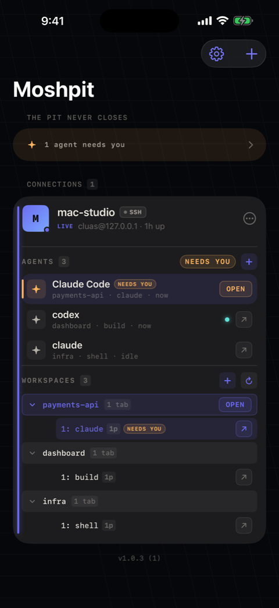
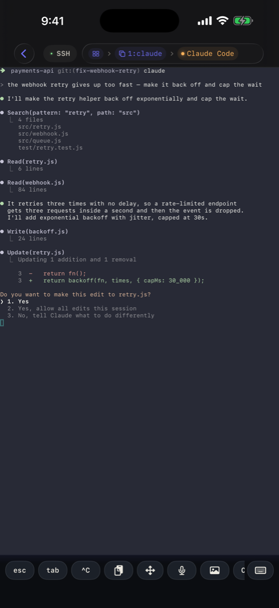
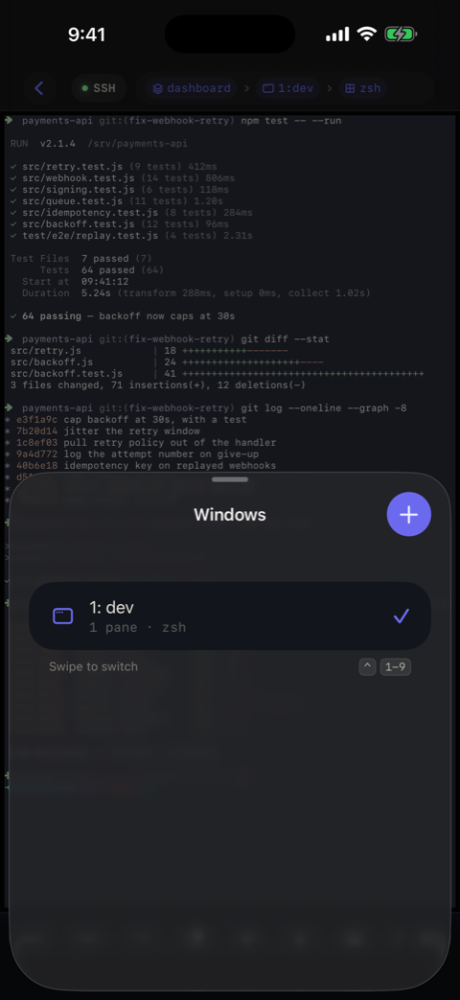
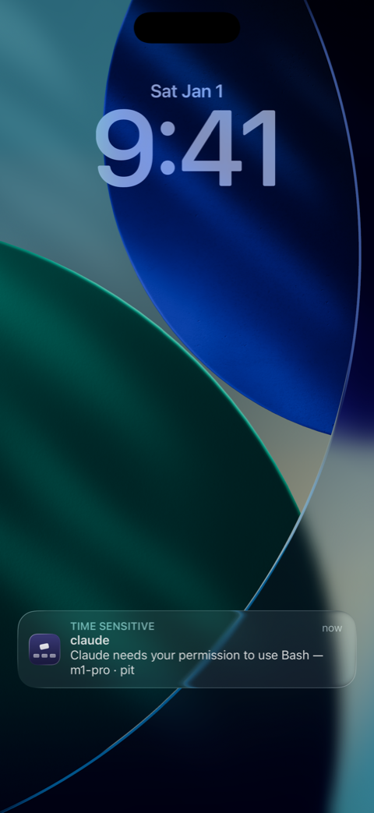
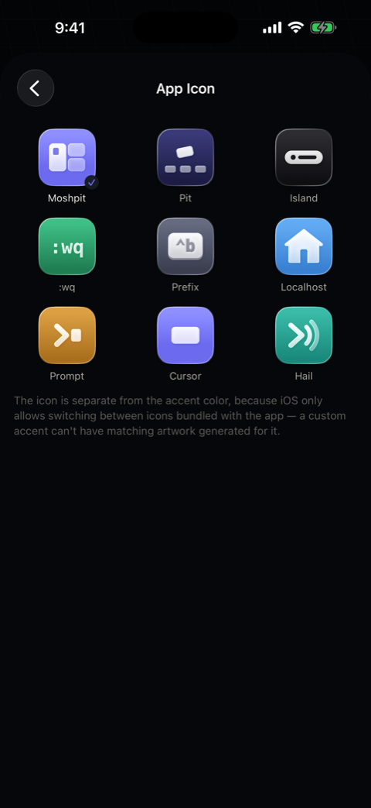

# Moshpit

**English** · [中文](README-zh.md)

**Moshpit is an SSH / Mosh / tmux terminal for iPhone and iPad, built for people
who run coding agents on remote machines.** Your Claude Code or Codex session keeps
working on the server. When it needs you, a Lock Screen alert drops you into the
exact pane that asked. In between, the Dynamic Island shows who is working, who is
waiting, and for how long.

[App Store](https://apps.apple.com/app/id6799896801) ·
[Website](https://moshpit.cluas.eu.org) ·
[Docs](https://moshpit.cluas.eu.org/docs) ·
[Issues](https://github.com/Cluas/moshpit/issues)

## Screenshots

| Agents at a glance | An agent's pane | tmux windows | Needs-you alert | Nine icons |
|---|---|---|---|---|
|  |  |  |  |  |

## What it does

**A real terminal first**

- SSH and Mosh, with Mosh's predictive echo. Sessions survive Wi-Fi/5G handoffs,
  sleep and bad hotel networks, and a connection that lived through the app being
  in the background is picked up again without a reconnect.
- tmux control mode: native rendering, swipe between windows and panes, create,
  rename and kill. No tiny fake desktop squeezed onto a phone.
- [herdr](https://github.com/herdrdev/herdr) support: the multiplexer built for
  coding agents, rendered one full-width pane at a time.
- A terminal drawn with Metal on a fork of wezterm's terminal core: inline images
  (kitty, iTerm2, sixel), find in the scrollback, selection with handles, and
  scrolling through history that keeps its momentum.
- iPad: hosts on the left, the terminal on the right, tmux pickers as popovers.
  ⌘K, ⌘1–⌘9 and ⌘W on a hardware keyboard.
- Custom themes, seven terminal fonts, nine Liquid Glass icons, a key bar for
  esc / ctrl / alt / arrows, IME composition, tappable links, on-device dictation.
- Each host wears a face drawn from its host key, the same key always the same
  face, or an emoji you pick.

**Built for agent work**

- Every agent at a glance: who needs you, who is working, for how long, who is idle.
- Needs-you pings on the Lock Screen, encrypted end to end and delivered even with
  the app closed. Tap one and you are in the pane that asked.
- Files an agent mentions open on the phone: tap a path in the output to preview
  an image, play a video or read a file, browse its folder, and share it on.
- Start an agent on a fresh git worktree from your phone: pick a repo, name a
  branch, optionally hand it the first prompt.
- Share an image from any app straight into an agent's pane.
- A pixel companion that hatches from an egg on Home, perches on the card of
  whichever agent needs you most, takes on that agent's state, and keeps you
  company on the Dynamic Island and the Live Activity. With it on, each host's
  face becomes a pixel creature, drawn from the same key.
- Agent status needs zero host-side setup on herdr, and a one-line hook install on tmux.

**Honest by design**

- One-time purchase. No subscription, no accounts, no feature tiers.
- Nothing is collected: no analytics, no tracking. Keys stay in the iOS Keychain,
  and traffic goes only to your own servers, plus a push relay that sees ciphertext only.
- Moshpit never installs anything on your host silently, never creates sessions
  behind your back, and says so when it degrades instead of quietly switching transports.

Works with any SSH server. Mosh, tmux and herdr are optional; install guides are built in.

## How it is built

Most of Moshpit is Rust. The core lives in `crates/`: the SSH transport
(`ssh`, on russh), Mosh's protocol (`mosh`), the session layer that dials,
reconnects and resumes (`session`), tmux control mode (`tmux`) and herdr
(`herdr`), the terminal emulator (`term`, our wezterm fork in `vendor/wezterm`),
what the app keeps (`store`), the agents' state machine (`agents`), the
companion (`pet`), and host setup and push pairing (`hostcare`, `install`,
`seal`). The screens are written
in Rust too, with [NSH](https://nsh.dev), in `ui/`. On iOS a thin Swift layer
hosts all of it through one static library (`crates/ffi`): the app shell, the
terminal view's Metal drawing and text input, the Keychain, voice input, and
the parts iOS keeps to itself (the Live Activity and widgets, the notification
service that decrypts pushes, the share extension). An Android app shares the
same core and screens (`crates/android`, `android/`); it is in development and
not released.

## Build from source

You need macOS with Xcode 27 (the app deploys to iOS 18),
[XcodeGen](https://github.com/yonaskolb/XcodeGen) via `brew install xcodegen`,
and Rust through [rustup](https://rustup.rs). The repository pins its toolchain
in `rust-toolchain.toml`, so rustup installs the right one on first use.

```sh
git clone https://github.com/Cluas/moshpit.git
cd moshpit
xcodegen generate        # project.yml is the source of truth; the .xcodeproj is generated
open Moshpit.xcodeproj
```

Pick the **Moshpit** scheme and a simulator, then press ⌘R. The app target's
"Build Rust" phase runs `scripts/rust/build-ios.sh`, which builds `crates/ffi`
into `libmoshpit_ffi.a` for the simulator or the device, adding the Rust target
it needs (`aarch64-apple-ios-sim`, `aarch64-apple-ios`) the first time. Debug
builds use the `app-test` cargo profile, Release builds `app`. The first build
compiles the whole Rust graph and takes a while; later ones are incremental.
The Swift packages resolve on the first build too.

A device build needs your Team ID in `Signing.xcconfig`; the comment in that
file and [docs/install-free-account.md](docs/install-free-account.md) walk
through it, including the free Apple ID path.

### Tests

The Rust side, as CI runs it:

```sh
cargo test --workspace --locked
cargo clippy --workspace --all-targets --locked -- -D warnings
cargo test -p moshpit-term        # one crate
```

The iOS app, as CI runs it on the Xcode 27 image:

```sh
scripts/rust/test-build-ios.sh    # the Rust phase's profiles and links, without building
xcodebuild test -project Moshpit.xcodeproj -scheme Moshpit \
  -destination 'platform=iOS Simulator,name=iPhone 18 Pro' CODE_SIGNING_ALLOWED=NO
```

A few suites skip on an unsigned build (they need the App Group container) or
off the iPad simulator (hardware-keyboard shortcuts), and some UI flows skip
until they are written again for the current screens; the log names each one.

The Android app builds and tests with `android/ci.sh`, which fetches what it
needs (the SDK parts, the NDK, Gradle) beside a JDK 17.

## Repository layout

| Path | What lives there |
|---|---|
| `crates/` | The Rust core, one crate per concern: `ssh`, `mosh`, `session`, `tmux`, `herdr`, `term`, `stream` (a pane's bytes between the core and the terminal view), `store`, `agents`, `pet` (the companion), `seal`, `hostcare`, `install`, `app` (the screens' models), `runtime`, `copy` (the rules the Chinese copy keeps), `ffi` (the static library iOS links), `android` (the Android app's Rust half) and two early spikes |
| `ui/` | The screens, written in Rust with NSH and shared by iOS and Android |
| `vendor/wezterm/` | Our fork of wezterm's terminal emulator, behind `crates/term`; [docs/WEZTERM-PATCHES.md](docs/WEZTERM-PATCHES.md) lists what it changes |
| `Moshpit/` | The iOS host: the app shell, the Swift side of each screen, the terminal view's Metal drawing and text input, the Keychain, voice input (WhisperKit) |
| `Extensions/` | The three app extensions: `MoshpitIsland/` (Live Activity and Lock Screen widget, Vibe Island), `MoshpitPush/` (notification service that decrypts pushes on the device), `MoshpitShare/` (hand an image to an agent's pane) |
| `Packages/MoshpitKit/` | Local Swift package the app and all three extensions link: logging, the Live Activity payload, the sealed-push envelope and pairing store |
| `android/` | The Android app (Gradle), in development |
| `Tests/` | `MoshpitTests/` unit tests, `MoshpitUITests/` UI tests |
| `push-relay/` | The stateless Go relay between your host and APNs, with its deployment manifest under `deploy/` |
| `docs/` | [ARCHITECTURE.md](docs/ARCHITECTURE.md), [PUSH.md](docs/PUSH.md) (the push protocol end to end), [WEZTERM-PATCHES.md](docs/WEZTERM-PATCHES.md), `nsh/` (design notes on the Rust core and the NSH screens), design notes |
| `scripts/` | `rust/` the iOS library's build and its Swift bindings, `host/` the shell installed on your dev host, `gen/` generators, `verify/` end-to-end checks, `spikes/` experiments, `wezterm/` the fork's upstream imports, `release/` archive tooling |

The app talks to the maintainer's relay by default; [docs/PUSH.md](docs/PUSH.md)
explains what the relay can and cannot see and how to run your own.

## Contributing

Read [CONTRIBUTING.md](CONTRIBUTING.md) for the workflow and the house style,
and [SECURITY.md](SECURITY.md) before reporting anything sensitive. Everyone here
follows the [Code of Conduct](CODE_OF_CONDUCT.md).

## Community

Moshpit is shared on [LINUX DO](https://linux.do), a developer community in Chinese.
Questions and ideas are as welcome there as in the issue tracker.

## License

Moshpit is free software, released under the [GNU General Public License v3.0](LICENSE)
(GPL-3.0-only). You may build, modify and redistribute it under the terms of that
license. The App Store build is published by the maintainer, who holds the copyright.
Third-party components keep their own licenses, listed in [NOTICES.md](NOTICES.md).
