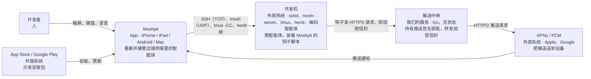
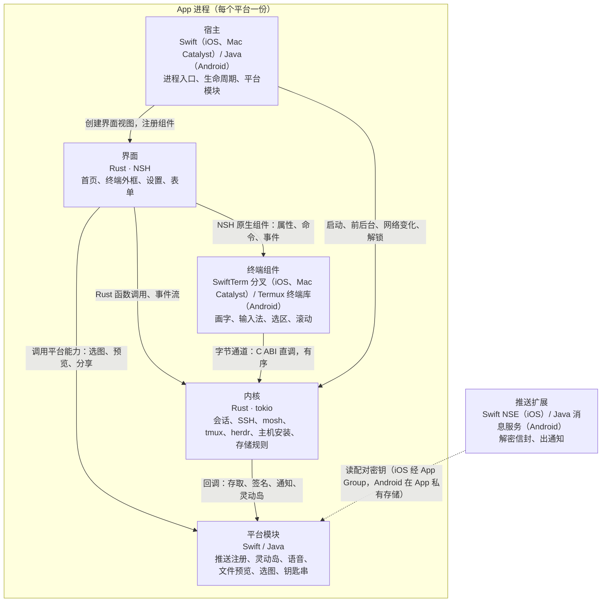
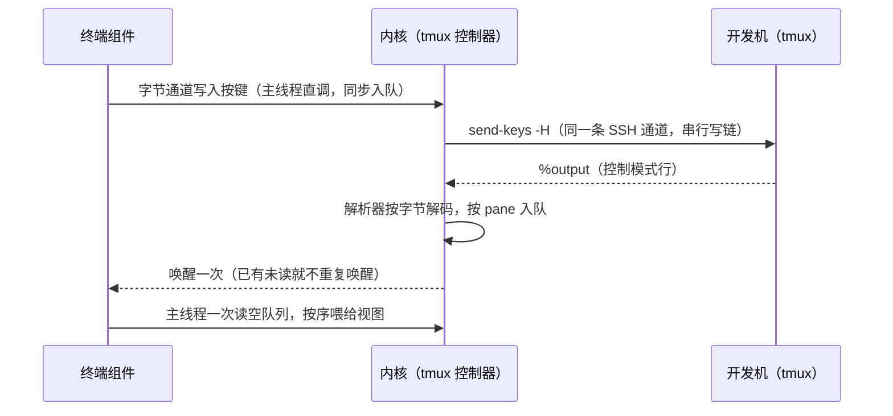

# Moshpit 多端：内核换 Rust，界面换 NSH（设计文档）

作者：Cluas（Claude 起草）　评审人：Cluas　状态：草稿　更新：2026-11-11
相关链接：进度和老 bug 账 [`PROGRESS.md`](PROGRESS.md) · NSH <https://github.com/longbridge/nsh> · 文档 <https://nsh.dev>

给谁看：做 Moshpit 的人和替他干活的 agent。解决什么问题：Moshpit 只能跑在 iPhone 和 iPad 上，开发者的 Android 手机和 Mac 用不了。范围：把会话、传输、协议逻辑搬进一个 Rust 内核，把界面用 NSH 重写，先出 Android，再出 macOS；iOS 版在迁移期间照常发版，而且质量优先于新平台的进度。Windows、Linux、Web 和国内 Android 商店不在本期。

本文不随公开仓导出（`docs/nsh/` 不在 `scripts/export-oss.sh` 的 `PUBLIC` 里）。名词见文末名词表。

## 1. 背景与范围

Moshpit 是给开发者用的远程终端，主打在手机上看着、接管开发机上跑的编码智能体。它已经上架 App Store（买断制），有付费用户。2026-11-11 定的方向：Moshpit 继续开发，用 NSH 做成多端。另一款产品 Foyer 面向不写代码的人，两者并行，不共用界面。

现状（2026-11-11，v2 `fd87248f`）：

- 代码 5.08 万行 Swift：服务层 2.35 万行，界面 1.93 万行，模型 4.3 千行，共享包 MoshpitKit 1.7 千行，扩展 1.2 千行，App 入口 0.8 千行。单测 1005 个（iPad mini 上全量跑 1.5 分钟，逻辑失败为 0），UI 测试 27 个。
- 传输：SSH 用 Citadel（基于 swift-nio-ssh）。mosh 是自己写的客户端（SSP、AES-128-OCB3、手写 protobuf、zlib、预测回显）。tmux 走 `-CC` 控制模式。herdr 走帧通道加 exec 轮询。
- 终端视图是 SwiftTerm 的分叉（30 个提交、约 1270 行改动，大部分在 iOS 视图层）。服务层直接创建并持有每个 pane 的 `TerminalView`。mosh 预测回显直接写 SwiftTerm 的格子。
- 平台能力：APNs 远程推送（我们的推送中继是无状态的 Go 服务，只持有签名钥匙，信封端到端加密）、通知服务扩展（NSE）解密、灵动岛和 Live Activity、端侧语音、分享扩展、App Intents、备用图标。
- 存储：连接、钥匙元数据、快捷键、约 30 个设置项在 `UserDefaults.standard`（JSON）；推送配对密钥等在 App Group；私钥和已知主机在钥匙串，私钥读取要 Face ID；开发机上的脚本在 `~/.moshpit/`。解锁前无人值守启动会读到空的 `UserDefaults`，所以有 `DefaultsReadiness` 门：数据可信之前不写回。
- 界面：SwiftUI，只有深色，iOS 18 起，iOS 26 上用 Liquid Glass。821 个本地化键、9 种语言，3 处用了复数。iPad 用分栏，有 ⌘ 快捷键和 popover。88 处无障碍标识，UI 测试靠它们和英文文案定位。

NSH 是 Longbridge 开源的跨端原生界面框架（Rust，Apache-2.0），维护者是 Cluas 在 Longbridge 的同事。一份 Rust 组件代码，在 iOS 渲染成 UIKit，在 Android 渲染成 View，在 macOS 渲染成 AppKit；任何原生视图可以注册成「原生组件」嵌进去。2026-11-09 Foyer 在 iPhone（iOS 27.3）和 iPad mini（iOS 18.2）上验证过三件事：原生组件能拿焦点、弹键盘、接输入法；Rust 代码能在 NSH 的引擎线程上跑 tokio 和裸 TCP；341 行的长列表滚动 80 fps 以上。Android 上没人验证过。

NSH 和本设计相关的事实（读主干 `c16a700` 得出）：

- 发过 0.1 到 0.4 四个版本（10-17 到 11-04），每个都改坏过接口。兼容承诺只管 TSX 写法，嵌入层（iOS、Android 的宿主接口）不在里面。crates.io 上的 iOS 包编不过，只能用主干。iOS 最低支持 15，Android 最低 API 26。
- 原生组件的命令走 JSON，跟着引擎每一轮的提交发出，只能在引擎线程上调用。没有传字节的通道，文档要求「只传标识和小值」。
- 一个 App 可以开多个 NSH 视图。Rust 根组件嵌进 Swift App 要自己写一层 C 接口（Foyer 已经写过）。同一个 App 链两个 Rust 静态库会在链接时撞运行时符号。
- macOS 的宿主只能是 Rust，没有 Swift 宿主 SDK；但同一套 iOS 框架能跑在 Mac Catalyst 里。
- Android 上 Rust 根组件加 Java 原生组件，官方打包加不了 Java 代码，要自己拼宿主。
- 有键盘高度接口（`.mb_keyboard()`，系统键盘弹出就算，不管谁是第一响应者），有 `.test_id()`（落成 iOS 的 accessibilityIdentifier、Android 的资源 id），能把 App 自己的 tokio 运行时交给 NSH 用。
- 没有的：远程推送、钥匙串、分享面板、文件预览、后台任务、网络变化通知、复数规则、iPad 分栏、列表左滑。元素被删时原生视图跟着销毁。祖先元素的点按会和原生视图自己的点按一起触发。
- G5 在 iPad 上实测：`on_key` 在 iOS 上也会触发（文档说只有桌面）；带 key 的重建先把旧元素移出窗口、再插入新元素，UIKit 会在中间收走键盘，同一轮里发给旧元素的命令会丢；自带的 `glass_effect` 在 iOS 26 以下的降级材质选的是浅色，深色 App 里要自己指定。

约束：

- iOS 版不能断更，迁移的每一步都要能单独发版、能回退。
- 不开 iOS 模拟器（会卡死开发机）。Swift 单测在 iPad mini 真机上跑；Rust 单测在 Mac 上跑。
- 开发机是 macOS 27：JDK 17 以上全部启动即崩，也没有 Rosetta。所以本机不能跑 Gradle。
- 公开仓是 GPL-3.0-only，按 `export-oss.sh` 导出。新加的依赖许可证要兼容。
- 一个人开发，大部分活由 agent 做，所以每一步都要有自动验证。

## 2. 目标与非目标

目标：

- 一份代码出 iOS、Android、macOS：新功能的界面和逻辑只写一次。每个平台只额外写两类东西：终端组件和平台模块（第 3.2 节）。NSH 缺的界面能力（iPad 分栏、列表左滑）用 NSH 的基础元素自己画，算共用代码。
- iOS 用户感觉不到迁移：回显延迟、输入法、手势、重连、推送、灵动岛都保持现在的水平。iOS 的质量和新平台的进度冲突时，iOS 优先。
- 迁移期间 iOS 照常发版：每次发版最多把一个模块的默认实现换成新的，换完能切回旧实现。
- 新平台里 Android 先做：它和 iPhone 是同一种用法（在手机上看智能体），开发者里用的人最多。
- 修掉迁移中发现的老 bug，每个修复都带回归测试。

非目标：

- 改版视觉：迁移照搬现在的样子。改版和迁移同时做，就没法对照验收。
- 在 iOS 上换掉 SwiftTerm：分叉里有大量 iOS 专属修复，换掉只有风险，用户得不到好处。
- Web 版：浏览器开不了 SSH 和 UDP 套接字，终端流量就得经过我们的服务器转发。我们不转发终端流量（推送中继只转发加密的通知信封）。
- Windows、Linux：要另做一套终端组件和宿主，成本和 Android 相当；macOS 走 Catalyst 几乎是白送的。macOS 上线后再评估。
- 国内 Android 商店：国内没有 Google Play，上架华为、小米等商店要另办软著和各家审核。源码照旧公开，能自己编。
- 跨设备同步主机列表：私钥本来就该每台设备一把，主机列表以后用导出、导入解决。
- 做 Foyer 的事（给所有人的智能体入口、配对、对话流）：那是另一款产品。

## 3. 设计

整体思路：自底向上换。先把协议和传输逻辑搬进 Rust 内核，在现有 iOS App 里逐个替换 Swift 模块；再用 NSH 重写界面，同一套界面跑 Android、iOS、macOS。每个平台只各写一份终端组件和平台模块，其余全部共用。

### 3.1 系统上下文

图：系统上下文（第一层）。框里写名字、类型、技术、职责；箭头写动作和协议。

App 直连开发机，终端流量不经过我们的服务器。唯一的服务器是推送中继，它只转发加密信封，看不到内容。多端之后多一条到 FCM 的路。

### 3.2 组成部分

图：组成部分（第二层）。实线是同一进程内的调用；虚线跨进程。

- **内核**（`crates/`，Rust）：所有不碰屏幕的逻辑。拥有 tokio 运行时、所有网络连接、会话状态机、协议解析、存储规则。不调平台 API，平台能力一律经回调。按模块分 crate：`session`（会话注册表、重连和保活、降级）、`ssh`（russh，含 SFTP、SOCKS5 代理、主机密钥首次信任）、`mosh`、`tmux`（`-CC` 解析器和控制器：尺寸租约、布局固定、会话跟随、回填）、`herdr`、`install`（主机脚本、钩子配置）、`store`（数据模型和读写规则）、`seal`（推送信封）、`ffi`（对外接口）。内核、界面和 NSH 编成同一个 Rust 静态库，每个 App 只链这一个。
- **界面**（`ui/`，Rust + NSH）：所有屏幕和外框，一份代码跑三个平台。只认内核的数据和事件，不碰套接字。终端屏的顶栏、胶囊、横幅、遮罩、快捷键条、底部面板都在这里画，叠在终端组件上面；它们和终端组件是兄弟元素，终端组件不放进任何可点的 NSH 容器里（祖先的点按会和终端自己的点按一起触发）。Liquid Glass 用一个包着 `UIGlassEffect` 的原生组件，iOS 26 以下退回半透明材质。本地化文件由现有的 xcstrings 管线生成，同一个来源；复数用 CLDR 规则自己补（NSH 没有）。
- **终端组件**：每个平台一份原生终端视图，注册成 NSH 原生组件 `moshpit/terminal`。iOS 和 Mac Catalyst 用 SwiftTerm 分叉的 iOS 视图；Android 用 Termux 的 terminal-emulator 和 terminal-view（GPLv3 加 Apache-2.0，和 Moshpit 的 GPL-3.0 兼容）。组件只做画字、输入法、选区、滚动、手势。
  - 终端视图常驻：NSH 删掉元素会销毁原生视图，所以视图不归 NSH 管，归宿主的一张视图表（按 pane 记）。组件每次挂上同一个视图，界面怎么重建，终端的内容和滚动历史都不丢。
  - 链接识别放内核：组件在输出停下 150 ms 后交一次可见行的文字和换行标记（和现在的节奏一样），内核还回要标的范围。
  - 预测回显在 iOS 上先保留现在的 Swift 实现（直接写 SwiftTerm 的格子）；Android 首发不做预测回显。以后要不要搬进内核，等 Android 版稳定后再定。
- **字节通道**：每个 pane 一条，直接连内核和终端组件，不经过 NSH 的属性。见 3.3 和 3.4。
- **平台模块**：只有一个平台才有的能力，用宿主的语言实现，内核和界面经接口调用。
  - iOS：APNs 注册、灵动岛和 Live Activity、语音（Speech、WhisperKit）、QuickLook、选图和相机、视频播放、分享面板、邮件、备用图标、App Intents、分享扩展、硬件键盘的 ⌘ 快捷键列表（`UIKeyCommand`）、钥匙串（含 Face ID 和 Secure Enclave 签名）。
  - Android：FCM 注册、语音识别（只用设备端识别；设备不支持就不显示语音键）、文件预览、选图、分享、Keystore。
  - Mac Catalyst：沿用 iOS 的模块，去掉灵动岛。
- **宿主**：进程入口。负责把生命周期、网络变化、解锁状态告诉内核，创建 NSH 视图，注册终端组件和平台模块。
  - iOS 宿主就是现在的 Xcode 工程，迁移期间旧界面也住在这里。Mac Catalyst 用同一个工程编。
  - Android 宿主是我们自己的 Java 代码：一个 Activity 起 `NshView`，注册 Termux 组件，跑 Rust 根组件；NSH 的 Java 运行时和 Rust 部分从同一个提交编出来。Spike 期间用脚本打包（javac、d8、aapt2、zipalign、apksigner）。正式包要接 Firebase 这类库，改在 CI 的 Linux 机器上用 Gradle 打（开发机跑不了 JDK 17 以上）。
- **推送扩展**：iOS 的 NSE 也走 `seal`（E7b）：它是单独的二进制，链自己那一个 Rust 静态库 `crates/seal-ffi`（只有 crypto、serde、libc，没有 tokio 和 NSH），一个 C 入口 `moshpit_push_receive` 做完收推送的整件事：用配对密钥解开信封，维护 App Group 里的在等集合、响过的完成和已结束的轮次，写诊断，返回要显示的卡片；Swift 只把结果映射到 `UNMutableNotificationContent`。「一个 App 一个 Rust 静态库」说的是同一个二进制里不能有两个，App 本身仍只链 `libmoshpit_ffi.a`（它把 seal-ffi 当普通依赖带进来，供在进程内驱动扩展的测试用：Debug 链接用 `-u` 留住这两个入口，Release 不带）；`nm` 查过两个静态库：入口各一份，`__rustc::__rust_alloc` 等运行时符号各一份，没有重复的全局定义。Swift 的 `MoshpitKit/Push` 随之删掉，几个比对 harness 从 git 读它最后的样子（8ef981c5）。实测：链进去约 0.85 MB，每条推送的峰值内存只多约 0.05 MB（Mac 上的代理测量，真机在 Canary 上量）。Android 的 Firebase 消息服务在 App 自己的进程里，经 `seal` 解密，密钥在 App 私有存储。中继加一条 FCM 路由：设备注册时上报令牌类型（APNs 或 FCM），开发机发信封时带上，中继按类型转发。

线程：内核建一个 tokio 多线程运行时，交给 NSH 复用（NSH 主干支持：iOS 经 `SurfaceOptions::runtime`，Android 经 `nsh::set_runtime`）。Apple 平台上运行时的线程设成 user-interactive 优先级：G1 实测默认优先级时，回显 p95 多出 0.7 ms，尾巴拖到 8 ms。内核的状态变化发到一条事件流，界面在 NSH 引擎线程上用一个任务接收、更新信号。不轮询。

### 3.3 关键流程

**按键到回显（SSH + tmux）。** 这是最敏感的一条路，延迟和顺序都在这里。

1. 组件在主线程收到按键，直接调 C 接口写进该 pane 的输入队列。没有 Task 跳转，没有 JSON。
2. 内核从队列按序取出，经同一条 SSH 通道的串行写链（每次写等上一次写完）发 `send-keys -H`。
3. tmux 回 `%output`，内核按字节解码，追加到该 pane 的输出队列。
4. 内核唤醒组件：一次唤醒覆盖所有未读字节，队列有未读时不再重复唤醒。
5. 组件在主线程读队列，按序喂给 SwiftTerm。平时一次读空；积压时每帧读一段（有时间预算），读空就停。不能连着往主队列塞读取任务：G1 实测这样会让好几段读取首尾相接，中间一帧都出不来。

两条规矩由结构保证：每个方向只有一个队列，所以不会乱序；队列不设上限、也不丢字节。修复帧（重新抓的整屏内容）也进同一条输出队列，排在它之前的字节后面。Foyer 的终端是每 50 ms 轮询一次、用 base64 JSON 走 NSH 属性，Moshpit 不能照抄：轮询会给回显加最多 50 ms，NSH 的组件命令又只能在引擎线程上发。

其他传输走同一对队列，只是内核里的编码不同：mosh 的服务器字节和 herdr 的帧解码后都进 pane 的输出队列；输入队列里的按键，内核按传输编码（tmux 用 `send-keys`，mosh 进状态同步，herdr 发帧消息）。

键盘也走终端组件自己的路：快捷键条用 NSH 的键盘高度（`.mb_keyboard()`）贴着键盘走；终端拿焦点靠组件自己的 `focus` 命令（NSH 没有给原生组件聚焦的接口）。⌘ 快捷键用 NSH 的 `on_key`，它只收到终端视图没吃掉的按键；iPad 上长按 ⌘ 弹出的快捷键列表由 iOS 宿主另外注册。

**启动和回到前台。**

1. 宿主启动，调 `Core::init`，传入存储、钥匙串、日志、通知这几个回调。
2. 内核检查数据能不能读：解锁前读到的空数据不可信，不写回，等宿主报「已解锁」再重读（沿用 `DefaultsReadiness` 的规则）。
3. 回到前台或网络变化时，宿主告诉内核；内核对断了的会话立刻重拨，按拨号代数（每次重拨加一的编号）丢掉过时的结果，后台超过 20 秒的强制重连。Android 和 iOS 一样不在后台保持连接，开发机上的状态靠推送送达。这些规则从 `SessionHub` 原样搬过来，带着现有的测试。

**推送到点开 pane。**

1. 开发机上智能体的钩子跑 `moshpit-push.sh`，用配对密钥封好状态，连同设备令牌和令牌类型发给中继。
2. 中继按令牌类型转给 APNs 或 FCM。
3. iOS 的 NSE（或 Android 的消息服务）用配对密钥解开，出通知。
4. 用户点通知，宿主收到深链 `moshpit://connection/<id>?pane=<pane>`，交给界面；界面让内核连上并切到那个 pane。

### 3.4 接口草图

只写形状，完整定义以代码为准。

**内核对外（UniFFI 生成 Swift 和 Kotlin 绑定，Android 宿主经 Java 调用 Kotlin 绑定的产物）：**

- `Core::init(config, services) -> Core`；`services` 是宿主实现的回调接口：`kv_get / kv_set`、`secret_get / secret_set`、`sign(key_ref, data)`（给 Secure Enclave 和 Keystore 用，私钥不出安全芯片）、`notify(...)`、`activity_update(...)`（灵动岛和 Android 的通知）、`log(...)`。
- `Core::connections()`、`Core::connect(id) -> Session`、`Core::on_lifecycle(event)`、`Core::on_network(path)`、`Core::on_push_token(kind, token)`。
- `Session`：`events() -> stream`（状态、pane 树、横幅、主机密钥提示）、`panes()`、`select / new / kill`、`answer_host_key(...)`、`disconnect()`。
- 每个 pane 带一个 `stream_id`，交给终端组件。

**字节通道（手写 C ABI，热路径不走 UniFFI；下面的 `id` 就是 `stream_id`）：**

- `mp_stream_attach(id, waker)`：组件挂上，`waker` 在任意线程被调用，组件自己切到主线程。
- `mp_stream_read(id, buf, cap) -> n`：主线程读空输出队列。
- `mp_stream_write(id, ptr, len)`：按键、粘贴，任意线程，同步入队。
- `mp_stream_resize(id, cols, rows)`。

**终端组件（NSH 原生组件 `moshpit/terminal`）：**

- 属性：`stream`、`theme`、`font`、`cursor`、`focus_policy`（点按时要不要弹键盘）。
- 命令：`focus`、`blur`、`scroll_by`、`copy`、`close_selection`。
- 事件：`size`、`focus`、`link_tap`、`selection`、`bell`、`title`、`clipboard_request`（远端程序请求读剪贴板，OSC 52）。
- 读屏幕：`mp_view_lines(id, ...)` 交可见行的文字和换行标记，内核还回链接范围。

### 3.5 数据与存储

- **iOS 不迁移数据。** 内核的键值存储经回调落到 `UserDefaults.standard`，键名和 JSON 格式与现在完全一致（Rust 的 serde 结构按现有 Swift Codable 的字段名和日期格式写，用 App 编出来的 JSON 当测试夹具）。老用户升级后数据原地可读，回退旧版也能读。Android 用 SharedPreferences，Mac Catalyst 和 iOS 一样。
- **私钥只存在系统的钥匙串里**（iOS 钥匙串、Android Keystore），内核的存储里只有钥匙的引用。导入的普通钥匙：签名时宿主取出私钥交给内核，内核在内存里用完即清零（`zeroize`）。Secure Enclave 和 Keystore 生成的硬件钥匙：私钥不出安全芯片，只经 `sign` 回调签名。
- **App Group 文件不变**：推送配对、待处理分享、灵动岛快照，扩展照旧读。
- **开发机上的 `~/.moshpit/` 不变**：脚本、钩子、推送配置的格式和路径都保持，新旧版本可以混用同一台开发机。

### 3.6 迁移步骤和回退

**开关。** 每个被替换的模块在 iOS 上有一个运行时开关（存在设置里，隐藏的调试页能切），选 Swift 旧实现还是 Rust 新实现。界面按屏换，每屏一个开关：G5 证明 NSH 屏幕能嵌进 SwiftUI 的导航栈，条件是三条——NSH 视图忽略安全区（包括键盘的，键盘归 NSH 管；SwiftUI 再避让一次，快捷键条会浮在键盘上方 340 pt）、隐藏 SwiftUI 的导航栏、界面重建走「交接」（先告诉宿主，终端短暂不交出第一响应者，键盘就不会掉下再弹起）。终端视图归宿主的视图表，所以 SwiftUI 屏和 NSH 屏可以共用同一个终端。一个模块的上线顺序：

1. 新实现进 TestFlight 的 Canary 组，Canary 包默认用新实现。
2. Canary 跑满一周，TestFlight 崩溃报告（ASC API 拉取）里没有相关崩溃、没有相关反馈，下一个商店版默认用新实现。
3. 新实现在商店里跑满两个版本，再删旧代码。在那之前，出了问题发一个默认切回旧实现的版本。

**步骤**（时长按一个人加 agent 估，总计约 4–6 个月）：

1. **Spike（1–2 周）**：过六道门，见下表。
2. **内核打底（2–3 周）**：工作区、FFI、存储和钥匙串回调、日志、生命周期。先搬纯逻辑（`-CC` 解析器、远端路径、链接识别、主机能力、安装清单和钩子配置、herdr 帧解析、mosh 编解码），带着测试一起搬；解析器在 iOS App 里接上开关。
3. **传输（4–6 周）**：SSH（russh）、mosh、tmux 控制器、herdr。先把服务层持有 `TerminalView` 的做法拆开：视图归终端组件，控制器只认 `stream_id`。然后 iOS 逐个切到 Rust。
4. **界面（4–6 周，和第 3 步重叠）**：按难度从小到大写 NSH 屏幕，在 iOS 开发包和 Android 上同时跑。写到最后一屏时，`docs/nsh/PARITY.md` 列出逐项对照的验收清单。
5. **Android 首发（2–3 周）**：宿主、Termux 组件、FCM、Keystore、语音、CI 上的 Gradle 构建、商店上架。
6. **iOS 换界面（2 周）**：按对照清单逐项验收，UI 测试改用 NSH 的 `.test_id()`，走上面的开关流程。
7. **macOS（2–3 周）**：Mac Catalyst。

**Spike 的门。** 门不过就按右列改路。

| 门 | 验证什么 | 过线标准 | 不过怎么办 |
| --- | --- | --- | --- |
| G1 字节直通 | Spike 小 App 里，内核到 SwiftTerm 的直通通道 | 真机上回显比现在多出的延迟 p95 ≤ 1 ms；50 MB 突发不乱序不丢（哈希一致）；主线程单次卡顿 < 32 ms；没有轮询计时器 | 找出慢在哪一跳并改掉；改不掉就让 iOS 的字节路径留在 Swift，只共享协议解析 |
| G2 内核替换 Swift 模块 | Rust 版 `-CC` 解析器接进现有 App | 现有解析器测试搬到 Rust 全绿；对录下的真实 `-CC` 字节流，新旧实现的输出逐字节一致（修掉的老 bug 除外，逐条记录）；真机 CPU 不高于旧实现 | 不一致的地方逐条查清；CPU 高就看 FFI 调用粒度 |
| G3 Android 终端 | NSH Rust App + Termux 终端组件，在 Android 模拟器上 | 打字、退格连删、方向键、输入法组字（测试直接调 `InputConnection`）、滚动、长按选区都正常；字节通道经 JNI 同样有序；有真机后补真手指三项 | 换别的 Android 终端库，或用 NSH 自带的 `Terminal` 元素 |
| G4 macOS 终端 | G1 的 Spike App 用 Mac Catalyst 编出来 | 能拿键盘焦点、打字、改窗口大小后行列跟着变；⌘ 组合键到达 NSH；鼠标滚轮、拖选、右键菜单都能用 | 任一项不能用就换 SwiftTerm 的 AppKit 视图，宿主换成 Rust，平台模块用 objc2 接 |
| G5 iOS 终端屏 | NSH 画外框，叠在 SwiftTerm 组件上 | 快捷键条贴着键盘走；键盘起落时终端不抖（保留现在的帧锁和截图遮罩）；界面重建后终端视图和滚动历史还在；iPad 硬件键盘 ⌘ 快捷键可用；能否把 NSH 屏幕嵌进现有 SwiftUI 导航 | iOS 界面先留 SwiftUI，只共享内核（第 4 节方案 B） |
| G6 构建 | 一条命令出包 | `xcodegen` 加构建脚本编 Rust；CI 跑 `cargo test`；安装包增大 ≤ 15 MB；Android 构建可重复 | 看是哪个 crate 撑大了包，裁掉或换掉 |

## 4. 备选方案

**方案 A：另起一个 NSH 新 App，做到功能对齐后一次切换。** 为什么有人会选它：不用写 Swift 和 Rust 之间的过渡层，新平台最快出来。取舍：迁移那几个月里同一套逻辑有两份，bug 要修两遍；iOS 切换是一次性的大跳，没有开关可以退。为什么不如选定方案：Moshpit 要继续开发，两份代码会一直分叉；而现有 1005 个单测只有在模块逐个替换时才能当回归网用。

**方案 B：只有新平台用 NSH，iOS 留 SwiftUI。** 为什么有人会选它：iOS 零风险。取舍：界面永远两份，每个新功能写两遍。为什么不如选定方案：违背「新功能只写一次」这个首要目标。保留它作为退路：如果 G5 不过，iOS 界面就先留 SwiftUI，只共享内核。

**方案 C：所有平台用同一个 Rust 终端引擎（如 alacritty_terminal），只把绘制留给平台。** 为什么有人会选它：读屏幕的逻辑只写一次，三个平台表现一致。取舍：要自己写三套绘制和输入法处理，而手机终端最难的正是输入法、选区手柄、滚动手感；iOS 上 SwiftTerm 分叉的修复全部作废。为什么不如选定方案：风险集中在 iOS 这个收入平台上。选定方案把链接识别放进内核，已经拿到了 C 的一部分好处。

**方案 D：Kotlin Multiplatform、Flutter 或 React Native。** 为什么有人会选它：生态成熟、招人容易。取舍：Flutter 和 React Native 不是原生视图，终端组件和输入法要绕路；Kotlin Multiplatform 的 iOS 界面仍是 SwiftUI。为什么不如选定方案：NSH 是原生视图，Foyer 已经在真机上验证过它的键盘、网络、性能，而且维护者是同事，有问题能直接找人。

**方案 E：用 Swift 的 Android SDK，把 SwiftTerm 引擎和现有服务层带到 Android。** 为什么有人会选它：现有 Swift 代码直接复用。取舍：Swift 的 Android 工具链还很新，Foundation 和网络库在 Android 上的成熟度没底，界面仍要另写。为什么不如选定方案：押在一条没人验证过的工具链上，而 NSH 没有 Swift 接口，界面层还是要 Rust。

**方案 F：Moshpit 不做多端，多端只在 Foyer 里做。** 为什么有人会选它：只维护一个多端产品。为什么不选：2026-11-11 定了 Moshpit 和 Foyer 是两种产品，Moshpit 偏开发者、要继续开发。

**方案 G：用 NSH 自带的 `Terminal` 元素。** 为什么有人会选它：一份代码三个平台，不用原生终端组件。取舍：它的引擎是 `vte`，用文字列表画行、用隐藏输入框收键盘，`write` 只收字符串；没人测过吞吐。为什么不如选定方案：输入法、选区、滚动手感它都还没证明过，Moshpit 在这些地方踩过几十个坑。它是 G3 不过时的退路，也是将来做 Windows、Linux 时的候选。

## 5. 横切关注点

**安全。** 私钥只存在系统钥匙串里，内核用完即清零；硬件钥匙只经回调签名。主机密钥首次信任的规则和存储位置不变。不新增服务器；中继只多一条 FCM 路由，信封格式不变，中继仍然看不到内容。

**隐私。** 语音只在设备上识别，两个平台都是。不加统计和遥测；判断新实现有没有问题，看 TestFlight 的崩溃报告和用户反馈。

**许可证。** 新依赖：russh、NSH、UniFFI、tokio 是 Apache-2.0 或 MIT；Termux 终端库是 GPLv3 加 Apache-2.0。Android 的 FCM 要链 Google Play 服务（闭源）：上架 Android 之前，在 `LICENSE` 里加一条 GPL 第 7 节的附加许可，允许和 Google Play 服务、Firebase 一起分发。Cluas 是唯一的著作权人，可以加；从 Foyer 搬来的两块代码也是他写的，能改成 GPL。

**可靠性。** 字节路径的两条规矩（不乱序、不丢）由字节通道的结构保证，并在 G1 里用哈希比对验证。每个替换都有开关和两个商店版本的回退窗口。解锁前启动读不到数据时，内核不写回。

**可观测。** 内核日志经回调进各平台的系统日志（iOS 的 `os_log`、Android 的 logcat），保留现在的分类。会话指标（每个会话的延迟、重连次数）搬进内核，设置里的「最近日志」页照旧能看。

**测试。** Rust 单测在 Mac 上跑，CI 的 Linux 机器上也跑。Swift 单测在 iPad mini 真机上跑；27 个 UI 测试也在 iPad 上跑，界面换成 NSH 后改用 `.test_id()` 定位。Android 的测试在模拟器里跑。

**上线与回退。** iOS 按第 3.6 节的开关流程。Android 先走 Play 的内测轨道（只对加了名单的人可见），再公开。Mac Catalyst 和 iOS 用同一个 App 记录，买一次两边都能用，推送照常走 APNs。

**运维。** Cluas 负责中继和商店账号。中继要加 FCM 服务账号；Android 要 Google Play 开发者账号，签名钥匙交给 Play 托管，上传钥匙放在 `~/.appstoreconnect/` 旁边。

**NSH 版本。** 在 `Cargo.toml` 里写死主干的一个提交（`rev`），Android 的 Java 运行时从同一个提交编。每月看一次上游，需要新能力时才升；升级就是改 `rev` 并重跑六道门。NSH 缺的能力先在宿主或界面层自己补；通用的再提给上游。

## 6. 未决问题

2026-11-11 Cluas 把取舍交给本设计决定。原先的五个问题，加上 G5 回答的「界面一屏一屏换还是整体换」（按屏换，见 3.6），定成这样：

- **Android 测试**：先用无窗口的 Android 模拟器（限 2 核 2 GB，测完就关）。输入法组字在测试里直接调视图的 `InputConnection`，等于模拟一个输入法在发组字。有真机后补真手指的三项：点和长按互斥、滚动手感、第三方输入法。
- **Android 怎么卖**：Google Play 付费买断，和 iOS 同一个价位。理由：一种模式，不写内购和授权校验。不发预编译的 APK；源码照旧按 GPL 公开。
- **从 Foyer 搬代码**：只搬 SSH 封装和 NSH 的 iOS 嵌入层，这两块是通用代码，可以随公开仓以 GPL 开源。Foyer 的其他部分不搬。
- **平台顺序**：Android 先。macOS 走 Mac Catalyst，成本低，G4 和 Android 并行验证。
- **Android 的硬件钥匙**：各平台各自生成（iOS 用 Secure Enclave，Android 用 Keystore），不互通；导入的普通钥匙两边都支持。

还没定的，都由 Claude 替 Cluas 定：

- **iPad 分栏和列表左滑怎么画**：候选：NSH 的 `Dock`、`Resizable` 和手写的拖动手势 / 包一个原生组件。期限：第 4 步写首页之前。
- **预测回显要不要搬进内核**：候选：搬，三个平台一份 / 留在各平台。期限：Android 首发之后。

## 附录：名词表

| 名词 | 意思 |
| --- | --- |
| 内核 | `crates/` 下的 Rust 代码：会话、传输、协议、存储规则。不碰屏幕、不调平台 API |
| 界面 | `ui/` 下用 NSH 写的 Rust 组件，三个平台共用 |
| 宿主 | 每个平台的原生 App 外壳（iOS、Mac Catalyst 用 Swift，Android 用 Java），进程入口 |
| 终端组件 | 每个平台一份的原生终端视图，注册成 NSH 原生组件 `moshpit/terminal` |
| 字节通道 | 内核和终端组件之间每个 pane 一条的有序字节队列，经 C ABI 直调 |
| 平台模块 | 只有一个平台才有的能力（推送注册、灵动岛、语音、文件预览等），用宿主的语言实现 |
| 开关 | iOS 上每个被替换模块的运行时选择：用 Swift 旧实现还是 Rust 新实现 |
| 门 | Spike 的过线标准，G1–G6 |
| Spike | 正式开工前，用最小的代码验证最没把握的几件事 |
| 会话 | App 里一条到开发机的连接（`Session`）；tmux 自己的会话叫「tmux 会话」 |
| pane | 终端里一块独立的屏幕。tmux 和 herdr 的窗格各是一个 pane；不用多路复用器的 SSH、mosh 会话只有一个 pane |
| 降级 | 能力不够时自动退一档，例如 mosh 的 UDP 不通时改走 SSH |
| 尺寸租约 | 多台设备开同一个 tmux 窗口时，谁定窗口大小：最后碰的那台设备持有，别的设备看到遮罩，点一下接管 |
| 布局固定 | 手机打开 tmux 窗口时把窗口大小钉在手机尺寸，离开时还原原来的布局 |
| 会话跟随 | tmux 那边切了会话，手机跟着切；只认自己客户端的切换 |
| 回填 | 刚连上时用 `capture-pane` 把屏幕和最近的历史抓回来 |
| 修复帧 | 本地画面和远端可能不一致时，重新抓一次整屏内容盖上去 |
| 拨号代数 | 每次重拨加一的编号，用来丢掉已经过时的连接结果 |
| 滚动历史 | 终端里滚出屏幕的旧内容（scrollback） |
| 预测回显 | mosh 网络慢时，先在本地画出按键的效果，等服务器确认 |
| 钩子 | 装在开发机上、智能体状态变化时自动运行的脚本，负责打状态标记和发推送 |
| 配对密钥 | 手机和开发机共享的密钥，用来加密推送信封 |
| `DefaultsReadiness` 门 | 判断存储里的数据可不可信：设备解锁过或写过哨兵键才算可信，可信之前不写回 |
| herdr | 一个面向编码智能体的终端多路复用器，Moshpit 经它的帧通道（JSON 帧）收画面、经 exec 命令查状态 |
| Foyer | Cluas 的另一款产品，给不写代码的人看智能体；和本设计无关的部分不在这里展开 |
| NSH | Native Shell，Longbridge 的跨端原生界面框架 |
| 引擎线程 | NSH 跑界面逻辑的那条线程；界面状态只能在这里改 |
| 根组件 | NSH 应用最外层的那个组件，整棵界面树从它长出来 |
| TSX | NSH 支持的另一种写法（类似 React 的 JSX），本设计不用 |
| UniFFI | Mozilla 的工具，从 Rust 接口生成 Swift 和 Kotlin 绑定 |
| C ABI | C 语言的二进制调用约定，Swift 和 Java（经 JNI）都能直接调 |
| JNI | Java 原生接口，Android 上 Java 和 Rust 互相调用的方式 |
| `InputConnection` | Android 输入法和输入框之间的接口，组字和提交文字都走它 |
| App Group | iOS 上 App 和它的扩展共享文件的容器 |
| `-CC` | tmux 的控制模式，客户端收结构化的输出行而不是画好的屏幕 |
| SSP | mosh 的状态同步协议，跑在 UDP 上 |
| NSE | iOS 的通知服务扩展，推送到达后在单独进程里解密、改写通知 |
| FCM | Firebase Cloud Messaging，Android 的推送通道 |
| Canary | TestFlight 里最先收到新构建的内部测试组 |
| 外部组 | TestFlight 里 Canary 之后的公开测试组 |
| 内测轨道 | Google Play 上只对名单里的人可见的发布通道 |
| Mac Catalyst | 苹果的工具，把 iPad App 编成 Mac App，界面仍是 UIKit |
